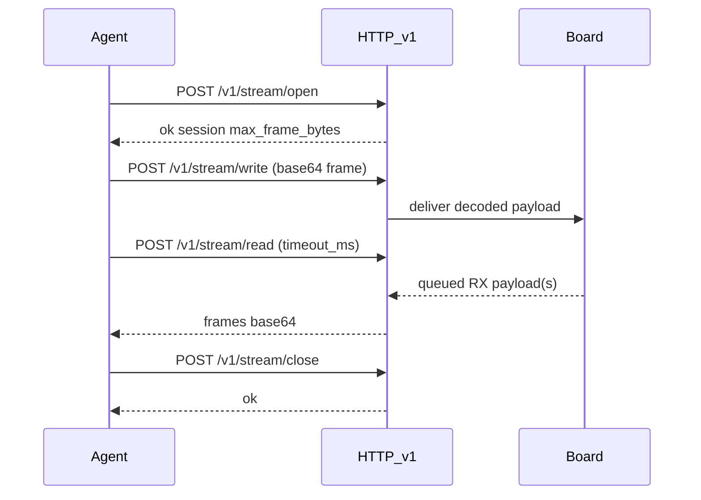

# External Host Stream API (Agent-Bounded Binary Frames)

Normative contract for **binary digital frame exchange** (for example bridging a
UART) between an **LLM agent** and the board.

Parent: [`docs/external_host_api_architecture.md`](external_host_api_architecture.md).  
Control companion: [`docs/external_host_command_api.md`](external_host_command_api.md).  
Source handoff: `EXTERNAL_HOST_API_V1_CONCEPT` (agent-primary),
`HOST_API_CAPABILITIES_ECHO_LOOPBACK`.

All agentic development methodology documentation in this firmware tree is
maintained in English.

## Purpose

Support opaque binary traffic without inventing a second transport the agent
cannot call safely:

1. **Open/close** a named stream session with HTTP JSON.
2. **Write/read frames** with **bounded** HTTP JSON calls (Base64 payloads).

The agent never holds a long-lived raw TCP socket in the terminal. Each tool
turn is a complete request/response.

Payload meaning is board-particular (`board_host_api_extensions.md`).

## Lifecycle



Rules:

- At most **one** open stream session per board in v1.
- Open requires host API active (STA + IPv4).
- Close is idempotent.
- `write` / `read` without a prior successful open return `unavailable` or
  `bad_request` (stable; see below).
- Decoded payload per frame: **0..1024** bytes.

## Frame Model

| Item | v1 value |
| --- | --- |
| Encoding in JSON | Standard **Base64** (RFC 4648), no newlines |
| Max decoded payload | **1024** bytes |
| Empty payload | Allowed (decoded length 0) if a board documents keep-alive/flush |
| Direction | Host→board via `write`; board→host via `read` (queued) |
| Duplex | Agent interleaves write and read across turns |

There is **no** CRC or encryption in v1 (LAN trust model).

## Control Endpoints

### Open

```text
POST /v1/stream/open
Content-Type: application/json
```

Request:

```json
{
  "id": "s1",
  "stream_id": "uart0",
  "params": {}
}
```

| Field | Type | Required | Rules |
| --- | --- | --- | --- |
| `id` | string | Yes | Correlation id (same rules as command API) |
| `stream_id` | string | Yes | Registered stream name (`[a-z0-9_]+`, max 64) |
| `params` | object | Yes | Stream-specific; may be `{}` |

Success:

```json
{
  "ok": true,
  "id": "s1",
  "api_version": 1,
  "result": {
    "stream_id": "uart0",
    "session": "1",
    "max_frame_bytes": 1024
  }
}
```

| Result field | Meaning |
| --- | --- |
| `stream_id` | Echo of opened stream |
| `session` | Opaque session token string (v1 may be `"1"`); pass to write/read/close |
| `max_frame_bytes` | Max decoded payload length (**1024** in v1) |

Errors:

| Condition | `error.code` |
| --- | --- |
| Unknown `stream_id` | `unknown_stream` |
| Session already open | `busy` |
| Board has no streams / feature off | `unavailable` |
| Bad JSON | `bad_request` |

### Close

```text
POST /v1/stream/close
Content-Type: application/json
```

Request:

```json
{
  "id": "s2",
  "session": "1"
}
```

| Field | Required | Rules |
| --- | --- | --- |
| `id` | Yes | Correlation id |
| `session` | No | If present, must match open session or close still succeeds idempotently |

Success:

```json
{
  "ok": true,
  "id": "s2",
  "api_version": 1,
  "result": { "closed": true }
}
```

After close, the board MUST discard any RX queue for that session and reject
write/read until a new open.

## Frame Endpoints (Agent Data Plane)

### Write (host → board)

```text
POST /v1/stream/write
Content-Type: application/json
```

Request:

```json
{
  "id": "w1",
  "session": "1",
  "payload_b64": "AQID"
}
```

| Field | Type | Required | Rules |
| --- | --- | --- | --- |
| `id` | string | Yes | Correlation id |
| `session` | string | Yes | Must match open session |
| `payload_b64` | string | Yes | Base64; decoded length 0..`max_frame_bytes` |

Success:

```json
{
  "ok": true,
  "id": "w1",
  "api_version": 1,
  "result": {
    "bytes_written": 3
  }
}
```

Errors:

| Condition | `error.code` |
| --- | --- |
| No open session / bad session | `unavailable` or `bad_request` |
| Invalid Base64 or decoded length > max | `bad_request` |
| Backend cannot accept now | `busy` or `timeout` |

Server command/stream handler timeout for write: **5 seconds** (same family
budget as slow commands unless a particular doc states a lower value).

### Read (board → host)

```text
POST /v1/stream/read
Content-Type: application/json
```

Request:

```json
{
  "id": "r1",
  "session": "1",
  "max_frames": 8,
  "timeout_ms": 500
}
```

| Field | Type | Required | Rules |
| --- | --- | --- | --- |
| `id` | string | Yes | Correlation id |
| `session` | string | Yes | Must match open session |
| `max_frames` | number | Yes | Integer 1..16; how many queued frames to return |
| `timeout_ms` | number | Yes | Integer 0..5000; wait for at least one frame if queue empty |

Behavior:

1. If the RX queue has frames, return up to `max_frames` immediately (do not
   wait the full timeout).
2. If empty and `timeout_ms` > 0, wait up to that time for the first frame, then
   return whatever is queued up to `max_frames`.
3. If still empty after timeout, return success with `"frames": []` (not an
   error). Agents poll with short timeouts across turns.

Success:

```json
{
  "ok": true,
  "id": "r1",
  "api_version": 1,
  "result": {
    "frames": [
      { "payload_b64": "BQYH", "bytes": 3 }
    ]
  }
}
```

| Result field | Meaning |
| --- | --- |
| `frames` | Array of frames (may be empty) |
| `frames[].payload_b64` | Base64 payload |
| `frames[].bytes` | Decoded length |

Errors:

| Condition | `error.code` |
| --- | --- |
| No open session / bad session | `unavailable` or `bad_request` |
| `max_frames` / `timeout_ms` out of range | `bad_request` |

Firmware SHOULD keep a small RX queue (implementation minimum: at least **16**
frames of up to 1024 bytes each, or document a lower particular limit). On
overflow, drop oldest frames and continue (particular docs MAY tighten).

## Base vs Particular Streams

**Reference board `b00_basehil` — demo stream `loopback` (not family-mandatory):**

- `info.streams_supported` MUST be `true` when `loopback` is implemented.
- `capabilities.streams` MUST list `loopback`.
- Behavior: after a successful open of `stream_id` `"loopback"` with `params`
  `{}` (or ignored empty object), each successful `write` enqueues the decoded
  payload into the session RX queue; `read` returns those frames (FIFO). No
  external UART/DUT pins required.
- Close clears the RX queue.
- Max payload remains **1024** bytes per family framing rules.
- Sibling boards do **not** inherit `loopback` unless they opt in via their own
  extensions + manifest.

**Boards with no streams:**

- `streams_supported: false`; `capabilities.streams: []`.
- `POST /v1/stream/open` returns `unavailable` or `unknown_stream`.
- Still MUST implement open/close/write/read routes for stable errors.

**Particular boards:**

- Register each `stream_id` (e.g. `uart0`, `logic_ch0`) in firmware
  `capabilities` and mirror in `board_host_api_extensions.md`.
- Implement the backend that maps frames ↔ hardware.

## Agent Guidance

Recommended turn sequence:

1. `POST /v1/command` `capabilities` → learn `stream_id` values from the board.
2. `POST /v1/command` `info` → confirm identity / `streams_supported` if needed.
3. `POST /v1/stream/open` with a manifest `stream_id` / `params`.
4. Loop as needed: `write` and/or `read` with short `timeout_ms` (e.g. 200–500).
5. `POST /v1/stream/close` when finished.

Do **not** open a raw TCP socket from the agent terminal for v1 streams.
Do **not** assume stream names from the git repo; use `capabilities`.

## curl Examples

```bash
# b00_basehil demo
curl -sS -X POST "http://HIL-00-24CE.local/v1/stream/open" \
  -H "Content-Type: application/json" \
  -d '{"id":"s1","stream_id":"loopback","params":{}}'
```

```bash
# particular UART example (only if announced in that board's capabilities)
curl -sS -X POST "http://HIL-06-XXXX.local/v1/stream/open" \
  -H "Content-Type: application/json" \
  -d '{"id":"s1","stream_id":"uart0","params":{"baud":115200}}'
```

```bash
curl -sS -X POST "http://HIL-00-24CE.local/v1/stream/write" \
  -H "Content-Type: application/json" \
  -d '{"id":"w1","session":"1","payload_b64":"AQID"}'
```

```bash
curl -sS -X POST "http://HIL-00-24CE.local/v1/stream/read" \
  -H "Content-Type: application/json" \
  -d '{"id":"r1","session":"1","max_frames":8,"timeout_ms":500}'
```

```bash
curl -sS -X POST "http://HIL-00-24CE.local/v1/stream/close" \
  -H "Content-Type: application/json" \
  -d '{"id":"s2","session":"1"}'
```

## Non-Goals

- Multiplexed concurrent streams on one board in v1
- Raw TCP port 9000 (or any agent-held socket) as the v1 data plane
- WebSocket as a required v1 transport
- Embedding high-rate continuous binary inside `POST /v1/command` without a
  stream session
- TLS on stream endpoints
- Standardized UART profile in the base (particular only)
