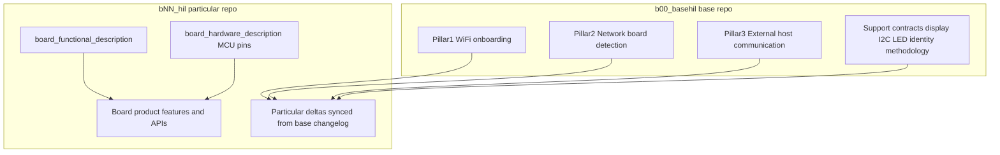

# HIL Base Platform Scope

Delimits what **must live in this base repository** (`b00_basehil`) versus what
**must live in each board's own repository** (`bNN_hil`).

Source handoff: `agent-workspaces/architect/handoff.md`, `HIL_BASE_REUSE_CONTRACT`
(extension: platform pillars and particular separation).

Related:

- Reuse rules: `docs/hil_base_reuse_contract.md`
- Base change log for LLM propagation: `docs/hil_base_spec_changelog.md`
- Particular-repo template: `docs/hil_board_particular_spec_template.md`

All agentic development methodology documentation in this firmware tree is
maintained in English.

## Purpose

An LLM working on a derivative board must be able to answer, without chat
history:

1. Which behaviors are **base** (shared family platform)?
2. Which behaviors are **particular** (one board only)?
3. Which files are authoritative for each?
4. When a base file changes, where to look for the delta and how to apply it to
   the particular repo?

**Yes: base and particular specifications MUST live in different files** (and,
for particulars, typically in a different repository). Mixing base platform
rules and board-only product rules in the same normative file is forbidden.

## Base Pillars (Owned by `b00_basehil`)

This base repository owns three platform pillars. Normative detail for each
pillar lives in **dedicated base docs**, not in board-particular files.

### Pillar 1 — WiFi onboarding

**In base:** SoftAP provisioning portal, credential NVS profile, STA connect /
retry / failure UX contracts, factory reset of WiFi credentials, related OLED /
error-LED mappings that are part of the shared onboarding experience.

**Authoritative base docs (non-exhaustive; see reuse contract table):**

- `docs/wifi_provisioning_architecture.md`
- `docs/wifi_factory_reset_architecture.md`
- `docs/wifi_connect_cycle_architecture.md`
- `docs/wifi_runtime_reconnect_architecture.md`
- `docs/wifi_provisioning_first_connect_failure_flow.md`
- `docs/wifi_provisioning_first_connect_failure_ux_proposal.md`
- Related error-LED WiFi/runtime/cycle docs

**Not in base pillar files:** board-specific GPIO numbers unless marked as the
base hardware profile example; product copy unique to one board SKU.

### Pillar 2 — Network board detection

**In base:** Mechanism and protocol for discovering HIL boards on the LAN (today:
mDNS hostname `HIL-<board>-<MAC4>`), shared identity string format, and rules for
when discovery is active (STA with IPv4) versus inactive (provisioning SoftAP).

**Authoritative base docs:**

- `docs/device_discovery_mdns_architecture.md`
- Identity rules also referenced from WiFi provisioning / architecture docs

**Board number** (`NN` in `HIL-NN-…`) is **configured** by each board repo but
the **format and protocol** are base-owned. Particulars MUST NOT invent a
second discovery protocol for the same family purpose.

### Pillar 3 — External host communication methodology

**In base:** How an external entity (LLM agent, desktop/mobile app, test harness,
or other host) communicates with **each** HIL board after the board is on the
user network: transport, API surface, protocol, message contracts, versioning,
and error model.

**Authoritative base doc:**

- `docs/external_host_api_architecture.md`

That document is the **only** normative home for family-wide host↔board
communication methodology. Board repos may expose **additional** product
endpoints or payloads **only** as particular extensions documented in their own
files, and those extensions MUST NOT contradict or fork the base host API
contract.

**Status note:** detailed request/response schemas may still be evolving; until
filled in, `docs/external_host_api_architecture.md` remains the reserved base
file. Particulars MUST NOT create a competing family-wide host protocol doc.

## Support Contracts Still Base-Owned

These are not separate “pillars” in the product sense but remain base normative
surface because onboarding, discovery, and host API depend on them:

| Support area | Base docs |
| --- | --- |
| Reuse / family rules | `docs/hil_base_reuse_contract.md`, this file |
| Engineering overview | `docs/architecture.md` |
| Display delivery / OLED / QR | `docs/display_delivery_contract.md`, `docs/oled_text_display_interface.md`, `docs/qr_encoder_interface.md` |
| I2C bus | `docs/i2c_bus_architecture.md` |
| Methodology / roles | `docs/methodology.md`, `AGENTS.md`, `docs/architect_role_hard_stop.md` |
| Test strategy (base) | `docs/test_strategy.md` |

## Particular Surface (Owned by Each `bNN_hil` Repo)

Each board repository owns **different files** from the base pillars, typically
under that board's `firmware/docs/` (or equivalent).

Two particular documents are **mandatory and separate** because they change per
board and must be revisable independently:

| Particular concern | Lives in board repo |
| --- | --- |
| **Functional description** (what the board does: RS-485, relays, logic analyzer, …) | `docs/board_functional_description.md` |
| **Hardware description** (MCU/module, peripherals, pin→function map; may differ from base) | `docs/board_hardware_description.md` |
| Board number constant (`NN`) | Board-owned config |
| Schematics / PCB | Board `pcb/` (authoritative for pins) |
| Deeper product HIL channels, sensors, actuators, UX | `docs/board_product_architecture.md` (as needed) |
| Extensions to host API for board-unique commands | `docs/board_host_api_extensions.md` |
| Validation evidence on that PCB | Board tester records |
| Sync notes when absorbing a base changelog entry | `docs/board_base_sync_log.md` |

See `docs/hil_board_particular_spec_template.md` for required sections.

**Filled example:** this repository (`b00_basehil`) already contains concrete
`docs/board_functional_description.md` and `docs/board_hardware_description.md`
for the minimum human-supervised base bench (ESP32-C3 SuperMini). Copy the
file set/philosophy into `bNN_hil`, then rewrite those two files for that
board.

Particulars MUST NOT:

- Redefine WiFi onboarding, discovery protocol, or family host API in a way that
  replaces base docs.
- Edit `b00_basehil` normative files from the board repo workflow.
- Merge base pillar text and board-only product text into one ambiguous file.
- Merge functional mission and hardware/pin maps into one file when both need
  independent updates.
- Assume the base MCU or base GPIO map (`docs/esp32_c3_supermini_connections.md`)
  applies to another board.

## File Separation Rules

1. **One concern per normative file family.** Base pillars and particular product
   specs are separate files (and separate repos for board product).
2. **Base files never embed board-SKU product behavior** except as optional
   examples clearly labeled non-normative for other boards.
3. **Particular files never restate full base contracts.** They **reference** base
   doc paths/IDs and record **deltas** only.
4. **Every base normative change** that affects derivatives MUST append an entry to
   `docs/hil_base_spec_changelog.md` with a stable change ID.
5. **Every particular repo** that tracks the base SHOULD keep a sync log that
   cites those change IDs (see `docs/hil_board_particular_spec_template.md`).

## LLM Propagation Workflow

When base documentation changes:

1. Author (base architect) updates the relevant **base** pillar or support doc.
2. Author appends a dated entry with `BASE-CHANGE-YYYYMMDD-N` (or sequential ID)
   to `docs/hil_base_spec_changelog.md`, listing affected docs and required
   particular actions.
3. An LLM on `bNN_hil` reads **only new changelog entries** since the board's
   last synced ID.
4. The LLM updates **particular** files (functional description, hardware
   description, product, API extensions, local notes) and records the consumed
   change IDs in the board sync log.
5. The LLM does **not** copy entire base docs into the board repo as a fork;
   it keeps references + deltas.

## Non-Goals

- Automatically pushing base file copies into every board repo.
- Requiring identical peripheral sets on every board.
- Treating OLED/I2C support docs as optional for boards that still use the
  shared onboarding UX that depends on them.
- Defining board-unique HIL measurement semantics inside base pillar files.
