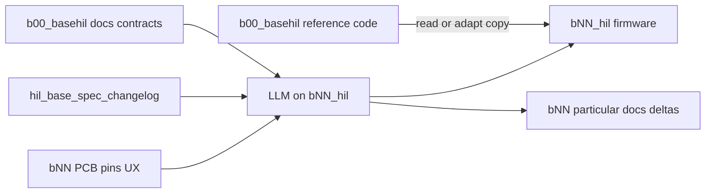

# HIL Base Reuse Contract

Normative contract for how sibling HIL boards reuse `b00_basehil` firmware
documentation and reference code.

Source handoff: `agent-workspaces/architect/handoff.md`, `HIL_BASE_REUSE_CONTRACT`.

All agentic development methodology documentation in this firmware tree is
maintained in English.

## Mission

`b00_basehil` started as firmware for a single board. The HIL product line is now
a **family** of boards (`b00_hil`, `b01_hil`, … `bNN_hil`, and this shared base
tree `b00_basehil`).

This firmware tree is the **shared base** for that family:

- **Normative shared surface:** contracts under `docs/**` (and architect handoffs
  that authorize them).
- **Reference implementation:** the ESP-IDF project in this tree (`main/`,
  `components/`, build config) that demonstrates those contracts on the base
  hardware profile.

Derivative board firmware lives in **each board's own repository**. Particular
specifications MUST use **different files** from base pillar docs. See
`docs/hil_base_platform_scope.md`.

## Base Platform Pillars (This Repo)

This base repository **owns** these three pillars end-to-end (docs + reference
code as authorized):

| Pillar | What stays in `b00_basehil` | Primary docs |
| --- | --- | --- |
| 1. WiFi onboarding | Provisioning SoftAP/portal, credential storage, connect/failure/reconnect/factory-reset contracts shared by the family | `docs/wifi_provisioning_architecture.md` and related WiFi/LED docs |
| 2. Network board detection | Mechanism/protocol to find boards on the LAN (mDNS / identity) | `docs/device_discovery_mdns_architecture.md` |
| 3. External host communication | Methodology (API, protocol, versioning) for an external LLM or application to talk to each board | `docs/external_host_api_architecture.md` |

Full delimiter of base vs particular, including support contracts (display, I2C,
methodology): **`docs/hil_base_platform_scope.md`**.

Board-unique product behavior (extra HIL channels, sensors, board-only commands,
PCB pins) is **out of these pillar files** and belongs in the board repo.

## Reuse Model (Contracts-First, No Submodule)

Reuse is designed for **LLM and human agents** working in each board's own
firmware tree:

Rules:

1. **Contracts first.** A derivative agent MUST read
   `docs/hil_base_platform_scope.md` and the normative docs for each pillar it
   ships before implementing or adapting platform behavior.
2. **Reference code second.** Agents MAY read, copy, or adapt source from this
   tree into the derivative tree. Adapted copies live in the derivative tree;
   they are not linked at build time into this tree.
3. **No package coupling.** Do **not** use git submodules, a shared library
   sub-repo, `EXTRA_COMPONENT_DIRS` pointing at `b00_basehil`, or any build-time
   dependency from `bNN_hil` into this repository path.
4. **Board identity stays board-owned.** Product strings such as
   `HIL-<board>-<MAC4>` take the two-digit board number from the derivative
   project (`b06_hil` → `06`). Do not hard-code `00` outside `b00_basehil`'s own
   board component.
5. **Separate files for base vs particular.** Do not mix family pillar rules and
   board-SKU product rules in one normative file. Particulars use the template in
   `docs/hil_board_particular_spec_template.md`.
6. **Propagate via changelog.** Material base doc changes append
   `docs/hil_base_spec_changelog.md`. Particular agents consume new
   `BASE-CHANGE-…` IDs and update only board-repo files + sync log.

This model prefers deterministic documentation over shared packaging so each
board session remains self-contained for agents while behavior stays aligned.

## Shared Surface (Normative)

### Delimiter and propagation

| Area | Normative document |
| --- | --- |
| Platform scope (base vs particular) | `docs/hil_base_platform_scope.md` |
| This reuse contract | `docs/hil_base_reuse_contract.md` |
| Base change log (LLM sync) | `docs/hil_base_spec_changelog.md` |
| Particular repo template | `docs/hil_board_particular_spec_template.md` |
| Engineering overview | `docs/architecture.md` |

### Pillar 1 — WiFi onboarding

| Area | Normative document |
| --- | --- |
| WiFi provisioning | `docs/wifi_provisioning_architecture.md` |
| First-connect failure | `docs/wifi_provisioning_first_connect_failure_flow.md` |
| First-connect failure UX | `docs/wifi_provisioning_first_connect_failure_ux_proposal.md` |
| Factory reset | `docs/wifi_factory_reset_architecture.md` |
| Connect cycle | `docs/wifi_connect_cycle_architecture.md` |
| Runtime reconnect | `docs/wifi_runtime_reconnect_architecture.md` |
| Error LED (WiFi / runtime / cycle) | `docs/error_led_wifi_link_architecture.md`, `docs/error_led_runtime_link_architecture.md`, `docs/error_led_connect_cycle_architecture.md` |

### Pillar 2 — Network board detection

| Area | Normative document |
| --- | --- |
| LAN mDNS / identity | `docs/device_discovery_mdns_architecture.md` |

### Pillar 3 — External host communication

| Area | Normative document |
| --- | --- |
| Host API / protocol methodology | `docs/external_host_api_architecture.md` |

### Support contracts (base-owned)

| Area | Normative document |
| --- | --- |
| Agentic methodology | `docs/methodology.md`, `AGENTS.md` |
| Architect hard stop | `docs/architect_role_hard_stop.md` |
| I2C bus | `docs/i2c_bus_architecture.md` |
| OLED text / layouts | `docs/oled_text_display_interface.md` |
| Display delivery | `docs/display_delivery_contract.md` |
| QR encoder | `docs/qr_encoder_interface.md` |
| Test expectations | `docs/test_strategy.md` |

Display visual demo protocol (`docs/display_visual_demo_protocol.md`) is
**retired** from product firmware. Derivative boards MUST NOT revive boot demos
unless a new base handoff explicitly authorizes a temporary test-only demo.

Base pin and SuperMini connection notes in
`docs/esp32_c3_supermini_connections.md` apply to **this** base hardware
profile. Derivative boards MUST confirm pins against **their own** schematic and
record board-local values; they MUST NOT assume base GPIO numbers are portable.

## Board-Owned Surface (Particular Repo)

Each `bNN_hil` repository owns **separate particular files** (see template).

Mandatory separate particular docs (vary per board):

- `docs/board_functional_description.md` — what the board does in the HIL
  system (for example RS-485 interface, relay card, logic analyzer).
- `docs/board_hardware_description.md` — MCU/module, peripherals, and
  schematic-confirmed pin→function map. Processor and pinout MAY differ from
  this base tree.

Also board-owned:

- `components/board/` (or equivalent): pin constants, board number, reset/LED
  polarity, and hardware-specific helpers derived from the hardware description.
- PCB and schematic under that board's tree (authoritative for pins).
- Deeper product features in board product architecture docs as needed.
- Host API **extensions** only in `board_host_api_extensions.md`, compatible
  with `docs/external_host_api_architecture.md`.
- `board_base_sync_log.md` consuming `BASE-CHANGE-…` IDs.
- Local agent workspaces and validation evidence for that board's hardware.
- Any adapted copy of base components after local integration (ownership of the
  copy is local; behavioral alignment remains governed by base contracts).

## Derivative Agent Brief

Before implementing firmware for `bNN_hil` (or another family member):

1. Read `docs/hil_base_reuse_contract.md` (this file),
   `docs/hil_base_platform_scope.md`, and `docs/architecture.md`.
2. Read `docs/hil_base_spec_changelog.md` and consume any IDs newer than the
   board sync log.
3. Read `AGENTS.md` / `docs/methodology.md` if the derivative tree adopts the same
   three-role workflow; do not cross roles without an explicit named switch.
4. Read pillar docs for WiFi onboarding, network detection, and external host
   API (plus support contracts the board will ship).
5. Create/maintain particular docs per
   `docs/hil_board_particular_spec_template.md` in the **board repo**, including
   separate `board_functional_description.md` and
   `board_hardware_description.md`.
6. Confirm MCU, pins, and peripherals against the **derivative** schematic
   (hardware description) before coding board constants; do not assume the base
   ESP32-C3 profile.
7. Set board number from the project identity (`bNN_hil` → `NN`); consume it via
   board-owned configuration for SoftAP SSID and mDNS hostname
   `HIL-<NN>-<MAC4>`.
8. Prefer adapting reference components from this tree over inventing alternate
   module boundaries for the same contracts.
9. Do **not** silently fork or weaken a base contract. If shared behavior must
   change for the whole family, change it in `b00_basehil` documentation first
   (architect handoff here + changelog entry), then propagate to derivatives.

## Change Ownership

| Change type | Where it is decided | File rule |
| --- | --- | --- |
| WiFi onboarding, discovery protocol, family host API | Architect handoff + base docs in `b00_basehil` | Base pillar files + changelog entry |
| Support contracts (display, I2C, methodology) | Architect handoff in `b00_basehil` | Base support docs + changelog when particulars are affected |
| Functional role of the board (RS-485, relays, …) | Board repo | `board_functional_description.md` only |
| MCU, pin maps, board number, PCB wiring | Board repo | `board_hardware_description.md` + board component |
| Board-unique product features / API extensions | Board repo | Particular docs; must not replace base pillars |
| Validation evidence on a specific PCB | Board tester records | Board repo |

Derivative agents MUST NOT rewrite base normative docs in place from a sibling
tree. Propose or request a base architect update when the family contract must
move.

## Non-Goals

- Git submodule or nested repository packaging of this base into other boards.
- CMake/`EXTRA_COMPONENT_DIRS` live dependency on `b00_basehil` paths.
- Automatic sync or mirror scripts as a substitute for contracts and changelog.
- Duplicating full base docs inside each board repo as a maintained fork.
- Treating this base as a non-buildable docs-only package; it remains a flashable
  reference project for the base hardware profile.
- Requiring every family board to ship every base peripheral (for example INA219)
  when the board PCB omits them; optional components stay optional per
  `docs/architecture.md`.
- Reviving retired display visual demos as product boot UX.
- Defining board-SKU HIL product semantics inside base pillar files.

## Acceptance (Documentation)

This contract is satisfied when:

- The three base pillars (WiFi onboarding, network detection, external host API)
  are explicitly owned by this repo and mapped to distinct docs.
- Base vs particular specifications are delimited in separate files/repos.
- `docs/hil_base_spec_changelog.md` exists so an LLM can find base deltas and
  apply them to particulars via a board sync log.
- Reuse without submodule/sub-repo is explicit and unambiguous.
- Board number and `HIL-<board>-<MAC4>` identity remain board-configured, not
  hard-coded to `00` in shared conceptual contracts.
