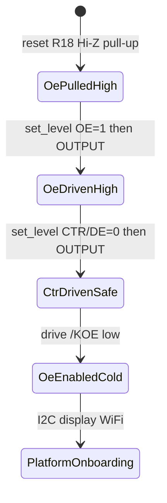

# Board GPIO Bring-up Architecture — `b02_hil`

Normative particular architecture for **boot-safe control GPIO initialization**
on `b02_hil` (74HCT541 `/KOE` buffer + ULN2003 relay drive + RS-485 DE line).

Source handoff: `agent-workspaces/architect/handoff.md`,
`B02_GPIO_BRINGUP_SAFE` (extends `B02_DAUGHTER_BOOTSTRAP` /
`B02_FIRMWARE_ADAPT_COPY`).

Pattern source (sister board, same hazard class):
`b03_hil` `docs/board_relay_control_architecture.md`
(`B03_RELAY_OE_LEVEL_BEFORE_DIR`).

All agentic development methodology documentation in this firmware tree is
maintained in English.

## Purpose

Freeze:

- Functional role of each relay and the DE control line (pin map)
- Module boundary for cold bring-up
- **Level-before-direction** init sequence so relays do not chatter while
  ESP32-C3 GPIOs are claimed
- What the implementer MUST ship in the first firmware adapt-copy (platform
  onboarding + safe GPIO cold state only)

Hardware authority: `docs/board_hardware_description.md` (PCB pinfunction).

## Product context (human-confirmed)

`b02_hil` is a **galvanically isolated UART** front-end:

- MCU UART crosses isolation to the DUT domain.
- One relay multiplexes the isolated UART between **TTL** and **RS-485**.
- Three further relays enable RS-485 **pull-up**, **pull-down**, and
  **termination** resistors.
- **ULN2003** (`U2`) sinks the relay coils.
- **74HCT541** (`U8`) buffers MCU control lines; active-low `/KOE` keeps
  outputs Hi-Z during ESP32 boot so spurious coil/DE activity cannot occur
  before firmware latches safe levels.

Cold bring-up (this file) authorizes adapt-copy base onboarding + safe GPIO
init ending in a known-safe electrical state.

**Single-channel runtime relay test API** (`relay_set` / `relay_get` for one
coil at a time, no masks) is authorized separately in
`docs/board_host_api_relay_architecture.md` (`B02_HOST_API_RELAY_SINGLE`).
DE / UART product control remains out of scope.

## Related documents

| Document | Role |
| --- | --- |
| `docs/board_hardware_description.md` | GPIO / net map |
| `docs/board_functional_description.md` | Product intent |
| `docs/board_particular_scope.md` | In/out of scope |
| `agent-workspaces/implementer/handoff.md` | `B02_FIRMWARE_ADAPT_COPY` |

## Normative language

`MUST` / `MUST NOT` / `SHOULD` / `MAY` as in base docs.

## Control path (hardware)

```text
MCU GPIO  -->  U8 74HCT541 (An→Yn)  -->  actuator
                     ^
                     G1 & G2 = /KOE  (active-low OE, pulled high by R18)

Actuators after U8:
  Y0..Y3 --> U2 ULN2003 I1..I4 --> K4..K1 coils
  Y4     --> 485_DRV --> ADuM1412 --> MAX485 DE/~RE (tied)
```

| Logical function | Relay / line | MCU CTR net | MCU GPIO | After buffer |
| --- | --- | --- | --- | --- |
| UART path mux TTL ↔ RS-485 | `K1` | `K1CTR` | `GPIO21` | `U2` → `K1` coil |
| RS-485 termination A↔B (`R6`) | `K2` | `K2CTR` | `GPIO9` | `U2` → `K2` coil |
| RS-485 pull-down on B (`R7`→GND2) | `K3` | `K3CTR` | `GPIO3` | `U2` → `K3` coil |
| RS-485 pull-up on A (`R8`←+3.3V) | `K4` | `K4CTR` | `GPIO4` | `U2` → `K4` coil |
| MAX485 drive enable | (no relay) | `485_CTR` | `GPIO20` | `485_DRV` → isolator → DE/`~RE` |
| Buffer output enable | — | `/KOE` | `GPIO2` | `U8` G1+G2 |

### Contact semantics (PCB-derived; cold = de-energized)

Omron G6K-2F class: de-energized COM connects to NC (pads `12`/`22`);
energized COM connects to NO (pads `14`/`24`) on the KiCad
`Relay_DPDT_Omron_G6K-2F-Y` numbering used on this PCB.

| Relay | De-energized (CTR=0, coil off) | Energized (CTR=1 after OE on) |
| --- | --- | --- |
| `K1` | UART mux on **TTL** (`UART1_*_MUX` ↔ `UART1_TTL_*`) | UART mux on **RS-485** (`↔ UART1_485_*`) |
| `K2` | Termination **off** | Termination **on** (`R_PU`—`R6`—`R_PD`) |
| `K3` | Pull-down **off** | Pull-down **on** (`R_PD` via `R7` to `GND2`) |
| `K4` | Pull-up **off** | Pull-up **on** (`R_PU` via `R8` from `+3.3V`) |

Cold-boot software target (this handoff): **all four coils off** → TTL path,
no PU/PD/term.

### Polarity

| Signal | Active meaning | GPIO level when active |
| --- | --- | --- |
| `/KOE` | Buffer **enabled** | **0** (active-low) |
| `KnCTR` | Relay coil **on** (after OE enabled) | **1** |
| `485_CTR` | Bootstrap **inactive / receive** level | **0** (MUST hold at 0 in this handoff; full DE polarity vs isolator inversion is deferred — do not drive the bus during bring-up) |

## Power-cycle hazard (same class as `b03_hil`)

On ESP32-C3, `gpio_config(..., OUTPUT)` / `gpio_set_direction(OUTPUT)` applies
the current OUT register bit (default **0**). `/KOE` is **active-low**, so
claiming OE as output **before** preloading OUT=1 briefly **enables** `U8`
while CTR/`485_CTR` may still be inputs, UART, or floating → spurious
`Yn` edges → relay clicks and/or DE glitches.

**Normative consequence:** every control GPIO bring-up step MUST use
**level-before-direction**. “Configure as OUTPUT, then set level” is
**forbidden**.

Note: `GPIO21` (`K1CTR`) and `GPIO20` (`485_CTR`) are default UART0 pins on
many ESP32-C3 modules — another reason OE must stay disabled until CTR/DE are
driven to safe outputs.

## Module boundary

### In scope for implementer (this handoff)

- Adapt-copy of base platform firmware (WiFi onboarding, display, identity,
  host API skeleton as constrained by `B02_FIRMWARE_ADAPT_COPY`)
- `components/board/` pin macros listed below
- New component **`components/board_ctrl/`** owning cold bring-up only
- Call `board_ctrl_init()` from `app_core_start` **before** I2C / display /
  WiFi (same ordering rule as `b03_hil` `relay_ctrl_init`)

### Out of scope (later architect handoffs)

- Runtime APIs to select TTL vs RS-485, enable PU/PD/term, or toggle DE for TX
- UART driver / host stream for DUT traffic
- OLED particular serial screens
- Changing family WiFi / discovery / host transport contracts

## Pin constants (`components/board`)

`board_pins.h` **MUST** define these exact names and values:

```c
#define BOARD_HIL_NUMBER_STRING        "02"

#define BOARD_I2C_SCL_GPIO             GPIO_NUM_0
#define BOARD_I2C_SDA_GPIO             GPIO_NUM_1
#define BOARD_ERROR_LED_GPIO           GPIO_NUM_8
#define BOARD_ERROR_LED_ACTIVE_LEVEL   0
#define BOARD_FACTORY_RESET_GPIO       GPIO_NUM_7
#define BOARD_FACTORY_RESET_ACTIVE_LEVEL 0
#define BOARD_OLED_ADDRESS_0           0x3C
#define BOARD_OLED_ADDRESS_1           0x3D

#define BOARD_CTRL_OE_GPIO             GPIO_NUM_2
#define BOARD_CTRL_OE_ACTIVE_LEVEL     0   /* /KOE active-low */

#define BOARD_UART_TX_GPIO             GPIO_NUM_5
#define BOARD_UART_RX_GPIO             GPIO_NUM_6
#define BOARD_TTL_IN_GPIO              GPIO_NUM_10

#define BOARD_K1_CTR_GPIO              GPIO_NUM_21  /* TTL/RS485 mux */
#define BOARD_K2_CTR_GPIO              GPIO_NUM_9   /* termination */
#define BOARD_K3_CTR_GPIO              GPIO_NUM_3   /* pull-down */
#define BOARD_K4_CTR_GPIO              GPIO_NUM_4   /* pull-up */
#define BOARD_485_CTR_GPIO             GPIO_NUM_20  /* MAX485 DE/~RE path */

#define BOARD_RELAY_CTR_ACTIVE_LEVEL   1
#define BOARD_485_CTR_INACTIVE_LEVEL   0  /* bootstrap receive / not driving */
```

Optional aliases `BOARD_KOE_GPIO` → `BOARD_CTRL_OE_GPIO` are allowed if both
are kept identical; prefer the `BOARD_CTRL_*` / `BOARD_K*_CTR_*` names above
in new code.

## Public C API (`components/board_ctrl`) — cold bring-up

Header `board_ctrl.h` **MUST** expose at least:

| Function | Behavior |
| --- | --- |
| `esp_err_t board_ctrl_init(void)` | Idempotent; runs normative sequence; `ESP_OK` if already inited |
| `bool board_ctrl_is_ready(void)` | `true` after successful init |

Single-coil set/get for host tests: see
`docs/board_host_api_relay_architecture.md` (`board_ctrl_relay_set` /
`board_ctrl_relay_get`). **MUST NOT** add mask/`set_all` or DE setters here
unless a later handoff says so.

CMake: `board_ctrl` REQUIRES `board`, `driver` (GPIO). `app_core` REQUIRES
`board_ctrl` and calls init early.

## Normative init sequence (`board_ctrl_init`)

Implementer **MUST** execute in this order:

```text
1. Create/take internal mutex; if already initialized → ESP_OK.

2. Preload OE inactive, THEN enable OE as output (level-before-direction):
   a. gpio_set_level(BOARD_CTRL_OE_GPIO, 1)   /* inactive = high */
   b. gpio_config / gpio_set_direction → OUTPUT on OE
   c. Pad MUST now drive /KOE high (buffer disabled)

3. For each of {K1,K2,K3,K4 CTR} and {485_CTR}, same rule:
   a. gpio_set_level(pin, inactive)
        KnCTR inactive = 0
        485_CTR inactive = BOARD_485_CTR_INACTIVE_LEVEL (0)
   b. Then configure pin as GPIO_MODE_OUTPUT
   Order among these five pins: any, as long as no pin becomes OUTPUT while
   its OUT bit is still wrong AND OE is already driving inactive from step 2.

4. Re-assert all five control outputs to inactive (belt and suspenders).

5. Drive OE active (gpio_set_level(BOARD_CTRL_OE_GPIO, 0)) — enable U8.
   After this step: all relays off (TTL, no PU/PD/term), DE path held inactive.

6. Mark initialized; release mutex; return ESP_OK.
```

Equivalent sketch (intent, not required helper names):

```c
gpio_set_level(BOARD_CTRL_OE_GPIO, 1);
gpio_set_direction(BOARD_CTRL_OE_GPIO, GPIO_MODE_OUTPUT);

const gpio_num_t ctrs[] = {
    BOARD_K1_CTR_GPIO, BOARD_K2_CTR_GPIO, BOARD_K3_CTR_GPIO, BOARD_K4_CTR_GPIO,
    BOARD_485_CTR_GPIO
};
for (each pin in ctrs) {
    gpio_set_level(pin, 0);           /* inactive for all five in bootstrap */
    gpio_set_direction(pin, GPIO_MODE_OUTPUT);
}

gpio_set_level(BOARD_CTRL_OE_GPIO, 0); /* enable buffer; actuators stay cold */
```



### Forbidden

- `gpio_config(OUTPUT)` / `gpio_set_direction(OUTPUT)` on OE **before**
  `gpio_set_level(OE, 1)`
- Claiming any CTR/`485_CTR` as OUTPUT before `gpio_set_level(..., inactive)`
- Enabling OE while any of those five pins is still input/UART/floating
- Enabling OE while any CTR is high or while `485_CTR` is not at inactive
- Relying only on `R18` after the MCU claims the OE pad
- Skipping `board_ctrl_init` or calling it after WiFi/portal bring-up starts
- Energizing `K1`…`K4` or asserting DE for product behavior in this handoff

### Boot ordering in `app_core_start`

```text
1. board_ctrl_init()     /* MUST be first among board actuators */
2. existing base bring-up (I2C / display / WiFi provisioning / …)
```

Failure of `board_ctrl_init` **MUST** be logged; implementer **MUST NOT**
continue into actuator-using code. Display/WiFi MAY still start if the
architect/base pattern already does so on non-fatal peripheral errors — but
relays/DE MUST remain unclaimed or held safe; prefer aborting further
`board_ctrl` use.

## Acceptance criteria (architect → implementer → tester)

1. Adapt-copy + identity `02` complete per `B02_FIRMWARE_ADAPT_COPY`.
2. `board_ctrl_init` implements the sequence above with level-before-direction.
3. Cold state after init: `K1`…`K4` coils off; `485_CTR` = 0; `/KOE` enabled.
4. Human/tester: no audible relay chatter on power-cycle / reset during
   platform onboarding bring-up (same pass criterion class as `b03_hil`).
5. SoftAP/mDNS identity uses board `02`; base onboarding UX still works.
6. No TTL/RS-485 mode or bias host commands shipped yet.

## Non-goals

- Full UART product stack
- Host API extensions for mux/term/DE
- Changing `b00_basehil` contracts
- Building/flashing as implementer

## Open questions (do not block this handoff)

1. Confirm on hardware that de-energized `K1` is TTL (NC) vs RS-485 — PCB
   numbering assumption above; if silk/measurement disagrees, return to
   architect with evidence before adding mux APIs.
2. Isolator inversion on the DE channel: whether GPIO `1` ever means drive.
   Bootstrap keeps `485_CTR=0` after OE enable; revisit before TX enable API.
3. Whether `TTL_IN` (`GPIO10`) is required in v1 product behavior.
