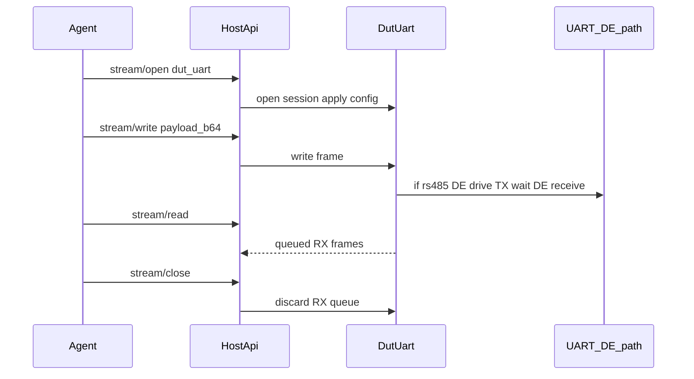

# Board UART Stream Architecture — `b02_hil`

Normative particular architecture for **binary DUT UART streaming** on
`b02_hil` over the family host stream API (`POST /v1/stream/*`).

Source handoff: `agent-workspaces/architect/handoff.md`, `B02_UART_STREAM`
(with `B02_UART_PATH_LINE` for path/line/config commands).

Family contracts (do not fork):

- `docs/external_host_stream_api.md`
- `docs/external_host_api_architecture.md`

All agentic development methodology documentation in this firmware tree is
maintained in English.

## Purpose

Freeze:

- Single product `stream_id` **`dut_uart`**
- Mapping frames ↔ isolated MCU UART (`GPIO5` TX / `GPIO6` RX)
- Automatic RS-485 **DE** assert/deassert around each TX frame
- RX queue / session rules / errors / module boundaries

Path (TTL vs RS-485) and line resistors are **not** owned here — see
`docs/board_uart_path_line_architecture.md`. Streaming uses whatever path is
currently selected.

## Related documents

| Document | Role |
| --- | --- |
| `docs/board_uart_path_line_architecture.md` | Path / line / config commands |
| `docs/board_gpio_bringup_architecture.md` | Pins, `/KOE`, `485_CTR` inactive default |
| `docs/board_hardware_description.md` | PCB |
| `docs/board_host_api_extensions.md` | Checklist |
| `docs/external_host_stream_api.md` | Open/write/read/close envelope |

## Normative language

`MUST` / `MUST NOT` / `SHOULD` / `MAY` as in base docs.

## Scope

### In scope

- Stream `dut_uart` only (no `loopback` on this board)
- Open / close / write / read backends
- DE sequence on write when path is `rs485`
- RX byte→frame queue for agent `read`
- Component `dut_uart` + host_api registration

### Out of scope

- Concurrent second stream
- Raw TCP / WebSocket
- User command to toggle DE
- Changing Base64 max frame (1024) or family paths

## Stream identity

| Item | Value |
| --- | --- |
| `stream_id` | `"dut_uart"` |
| Sessions | At most **one** open stream on the board (family v1) |
| Max decoded payload | **1024** bytes per family rules |
| Default framing (boot) | **9600 8N1** (`docs/board_uart_path_line_architecture.md`) |

`info.streams_supported` **MUST** be `true` when this stream ships.
`capabilities.streams` **MUST** list `dut_uart`.

## Lifecycle



## Open

`POST /v1/stream/open`

```json
{
  "id": "s1",
  "stream_id": "dut_uart",
  "params": {}
}
```

### `params` (v1)

| Field | Type | Required | Rules |
| --- | --- | --- | --- |
| (none required) | | | `{}` is valid |
| `baud` | int | No | Allow-list; applied like `uart_config_set` **before** arming RX queue |
| `data_bits` | int | No | 5…8 per `docs/board_uart_framing_architecture.md` |
| `parity` | string | No | `none` \| `even` \| `odd` |
| `stop_bits` | number | No | `1`, `2`, or `1.5` (1.5 only with 5 data bits) |

Unknown keys → `bad_request`.

If framing fields are omitted, use **current** stored UART config (boot default
9600 8N1 until changed by `uart_config_set` or a previous open override).

Open **MUST NOT** change path or line relays.

### Success

Family shape: `stream_id`, `session`, `max_frame_bytes` (1024).

### Errors

| Condition | `error.code` |
| --- | --- |
| Unknown id (not `dut_uart`) | `unknown_stream` |
| Already open | `busy` |
| Bad params | `bad_request` |
| Host API inactive | `unavailable` |
| UART init fault | `internal` |

## Close

Family close: discard RX queue; reject write/read until new open; idempotent.
On close, DE **MUST** be left inactive (receive). Path/line relays **MUST NOT**
be forced back to cold defaults (agent may keep rs485 + term for next open).

## Write (host → DUT)

Family `POST /v1/stream/write` with Base64 payload.

### Backend behavior

1. Decode Base64; length 0..1024.
2. Read current path shadow (`ttl` vs `rs485`).
3. If path is **`rs485`**:
   a. Assert DE **drive** (see polarity).
   b. Write all bytes to UART TX.
   c. Wait until TX complete (`uart_wait_tx_done` or equivalent; respect the
      family ~5 s handler budget; typical waits are milliseconds).
   d. Deassert DE **receive**.
4. If path is **`ttl`**:
   a. Ensure DE remains **inactive** (receive / not driving transceiver).
   b. Write all bytes to UART TX; wait TX done.
5. Return `bytes_written`.

Empty payload (0 bytes): still success with `bytes_written: 0`; if `rs485`,
**MUST NOT** leave DE stuck in drive (assert/deassert around a no-op TX is
allowed, or skip DE entirely for length 0 — prefer **skip DE toggle** when
length is 0).

### DE polarity (normative mechanism; bench-confirm levels)

| Logical state | `BOARD_485_CTR_GPIO` level (tentative) |
| --- | --- |
| Receive / inactive | `0` (`BOARD_485_CTR_INACTIVE_LEVEL`) |
| Drive (TX) | `1` |

Tentative assumption: isolator path is non-inverting so CTR high → MAX485
DE/`~RE` high → drive. **Tester MUST confirm** on hardware; if inverted,
architect issues a one-line polarity fix handoff — do not invent a second DE
API.

DE control **MUST** go through the same buffered `485_CTR` net as bring-up
(OE already enabled). Write path **MUST NOT** disable `/KOE`.

### Errors

Family codes: `bad_request`, `unavailable`, `busy`, `timeout`, `internal`.

If TX wait exceeds handler budget → `timeout` and DE **MUST** be forced back
to receive before returning.

## Read (DUT → host)

Family `POST /v1/stream/read` with `max_frames` / `timeout_ms`.

### RX path

- UART RX ISR or driver task pushes **frames** into a session queue.
- **Frame aggregation (v1):** each contiguous burst that ends when (a) RX has
  been idle for **≥ 5 ms** after at least one byte, or (b) accumulated length
  reaches **1024** bytes, becomes one frame. Implementer **MUST** document the
  chosen idle timer in notes if adjusting constants; defaults above are
  normative for v1.
- Queue depth: at least **16** frames; on overflow drop **oldest**.
- `read` behavior matches family stream doc (return queued frames; wait for
  first if empty; empty array on timeout — not an error).

Path/line changes while open do not flush the RX queue unless close is called.

## Module boundary

### New component `components/dut_uart/`

Responsibilities:

- UART port install on `BOARD_UART_TX_GPIO` / `BOARD_UART_RX_GPIO`
- Stored framing (default 9600 8N1); apply on init/open/config_set
- Session open/close; RX queue; write with DE sequence
- Query helpers: `dut_uart_is_open(void)`, `dut_uart_config_get/set`

Public header sketch (normative names):

```c
esp_err_t dut_uart_init(void);           /* boot: apply default 9600 8N1; DE inactive */
esp_err_t dut_uart_stream_open(const dut_uart_config_t *cfg_or_null);
esp_err_t dut_uart_stream_close(void);
esp_err_t dut_uart_stream_write(const uint8_t *data, size_t len, size_t *written);
esp_err_t dut_uart_stream_read(/* family queue pop API as designed */);
bool dut_uart_is_open(void);
```

`dut_uart_init` **MUST** run from `app_core_start` **after** `board_ctrl_init`
(so `/KOE` is enabled before any DE toggle). It **MUST NOT** open a stream
session by itself.

CMake: `dut_uart` REQUIRES `board`, `board_ctrl`, `driver` (UART/GPIO),
`freertos`. `host_api` REQUIRES `dut_uart`.

### `host_api` wiring

- `host_api_stream.c`: accept `stream_id == "dut_uart"`; reject others with
  `unknown_stream` (no loopback).
- Command handlers for `uart_config_*` call `dut_uart` config APIs; return
  `busy` if `dut_uart_is_open()` on set.
- Capabilities: include stream descriptor + updated summary (see extensions).

## Agent sequence (recommended)

1. `capabilities` / `info`
2. Optional: `uart_config_set` (if not using open params)
3. `uart_path_set` / `uart_line_set` as needed for the DUT
4. `stream/open` `dut_uart`
5. Interleave `write` / `read`
6. `stream/close`

## Acceptance criteria

1. Only `dut_uart` is openable; `streams_supported` true.
2. Default framing 9600 8N1 until changed.
3. RS-485 writes assert DE, wait TX done, return to receive; TTL leaves DE
   inactive.
4. Open does not move path/line relays; close leaves path/line as-is; DE
   inactive after close.
5. RX idle framing 5 ms / 1024 cap; queue ≥ 16; drop oldest on overflow.
6. `uart_config_set` busy while stream open.

## Open questions (non-blocking)

1. Confirm on bench: CTR=1 is MAX485 drive (else invert macro).
2. Whether idle gap 5 ms needs product tuning for very slow DUTs.

## Non-goals

- `loopback` stream on this board
- Multiplexed streams
- Exposing DE as `relay` channel or command
