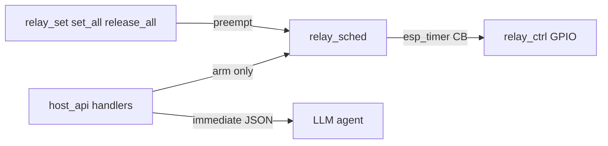

# Board Host API Relay v2 Architecture — `b03_hil` (LLM timed actions)

Normative particular architecture for **non-blocking timed relay actions** and
**encoder simulation** on `b03_hil`, on top of v1 state commands
(`relay_set` / `relay_set_all` / `relay_get` / `relay_get_all`).

Source handoff: `agent-workspaces/architect/handoff.md`,
`B03_HOST_API_RELAY_V2_LLM`.

v1 wire format remains: `docs/board_host_api_relay_architecture.md`.  
GPIO / OE: `docs/board_relay_control_architecture.md`.

All agentic development methodology documentation in this firmware tree is
maintained in English.

## Status

**Architecture complete — firmware PENDING implementer.**  
Do not mark implemented until acceptance criteria below pass on hardware.

## Purpose

Give an LLM agent reliable primitives for:

- Short key presses and long button holds (e.g. 10 s credential erase)
- Concurrent timed actions on multiple channels
- Quadrature encoder simulation (**two** relay channels + direction + speed)
- Single-wire pulse-train simulation (**one** relay channel)

…without blocking the MCU or the HTTP handler for the duration of the event.

## Non-blocking requirements (hard)

| Rule | Requirement |
| --- | --- |
| HTTP handlers | Validate → apply immediate GPIO if needed → arm `esp_timer` / state machine → return JSON **immediately** |
| Forbidden | `vTaskDelay` / `vTaskDelayUntil` for pulse/hold/encoder duration |
| Forbidden | Busy-wait / spin until `duration_ms` elapses |
| Forbidden | Any `wait: true` (or equivalent) that holds the HTTP response until OFF |
| Release / phase advance | **MUST** occur in `esp_timer` callbacks (or an equivalent non-blocking scheduler task), not on the httpd request stack |
| Observation | Agent uses `relay_get` / `hold_remaining_ms` / encoder status in a **later** turn |

Violating these rules is a **role/design failure**, not an optimization choice.

## Timing limits (electromechanical inertia)

Conservative limits for typical small electromechanical relays driven via ULN2003
(operate/release often ~5–15 ms; bounce + HIL margin → **20 ms** floor).

| Constant | Value | Meaning |
| --- | --- | --- |
| `RELAY_MIN_DURATION_MS` | **20** | Min ON time for pulse/hold/hold_many; min ON width in pulse train |
| `RELAY_MAX_PULSE_MS` | **4000** | Max `relay_pulse` duration |
| `RELAY_MAX_HOLD_MS` | **60000** | Max `relay_hold` / `hold_many` item duration |
| `RELAY_MIN_PHASE_MS` | **20** | Min `period_ms` between quadrature phase advances |
| `RELAY_MIN_TRAIN_PERIOD_MS` | **40** | Min full ON+OFF period for pulse train |
| `RELAY_MAX_PHASE_MS` | **1000** | Max `period_ms` (slowest useful speed) |
| `RELAY_MAX_SEQUENCE_MS` | **60000** | Max estimated total run time for encoder commands |
| Quadrature states per step `k` | **4** | Full-step quadrature state cycle per `steps` unit |

**Validation policy:** out-of-range values → outer error `bad_request` with an
ASCII `message` naming the limit (e.g. `duration_ms below RELAY_MIN_DURATION_MS=20`).
**MUST NOT** silently clamp.

Expose the same numbers under `capabilities.timing_limits` (see below).

## Runtime model

```text
Per channel 1..6:
  - shadow on/off (existing relay_ctrl)
  - optional one-shot release timer (pulse/hold)

Global:
  - at most one encoder run (quadrature XOR pulse_train)
```



### Conceptual module `relay_sched` (new)

Suggested paths (implementer MAY rename files if ownership stays clear):

```text
components/relay_sched/include/relay_sched.h
components/relay_sched/relay_sched.c
```

Public C API (normative behavior; signatures MAY add `esp_err_t` details):

```c
esp_err_t relay_sched_init(void);
esp_err_t relay_sched_pulse(int channel, uint32_t duration_ms);   /* arm ON + release timer */
esp_err_t relay_sched_hold(int channel, uint32_t duration_ms);    /* same backend as pulse */
esp_err_t relay_sched_hold_many(const relay_sched_item_t *items, size_t count);
esp_err_t relay_sched_cancel(int channel);                       /* channel 1..6 */
esp_err_t relay_sched_cancel_all(void);
bool      relay_sched_is_armed(int channel);
uint32_t  relay_sched_remaining_ms(int channel);                 /* 0 if not armed */

esp_err_t relay_sched_encoder_step(int channel_a, int channel_b,
                                   uint32_t steps, bool cw, uint32_t period_ms);
esp_err_t relay_sched_encoder_pulse_train(int channel, uint32_t pulses,
                                          uint32_t period_ms, uint32_t pulse_ms);
esp_err_t relay_sched_encoder_cancel(void);
bool      relay_sched_encoder_active(void);
```

- `relay_pulse` and `relay_hold` **MUST** share the same arming path; only the
  allowed `duration_ms` range differs at the host_api validation layer.
- `relay_ctrl_*` remains the only GPIO authority; `relay_sched` calls it under
  the existing mutex rules (or documents a single shared mutex).

### Facade

`app_core` **SHOULD** expose thin wrappers (`app_core_relay_pulse`, …) if that
matches existing `app_core_relay_set` style; host_api must not include
`driver/gpio.h` for relays.

## Preemption policy (manual wins)

| Incoming command | If channel has release timer / is in encoder run |
| --- | --- |
| `relay_set` on channel | **Cancel** timer on that channel; apply `on`. If encoder uses that channel, **abort encoder** first |
| `relay_set_all` / `relay_release_all` | Cancel timers for affected channels (all for release_all); abort encoder if any of its channels affected; apply mask |
| `relay_pulse` / `relay_hold` / item in `hold_many` | **Replace** that channel's timer (restart duration); channel ends ON |
| `relay_get` / `relay_get_all` | Do not cancel; include `hold_remaining_ms` |
| Second `encoder_step` / `encoder_pulse_train` while one active | `busy` (do not queue) |
| `encoder_cancel` | Abort encoder run; leave involved channels **OFF** |

Do **not** return `busy` merely because a hold timer is active when the agent
sends `relay_set` — preempt instead.

## v1 command extensions (result fields)

`relay_get` / `relay_get_all` success objects **SHOULD** add:

```json
"hold_remaining_ms": 0
```

- `0` or omit when no timer armed on that channel.
- When armed: milliseconds remaining until scheduled OFF (best-effort; MAY be
  floored to `esp_timer` resolution).

## New commands

Transport unchanged: `POST /v1/command` on STA host API only.

### `relay_pulse`

```json
{ "id": "p1", "name": "relay_pulse", "args": { "channel": 1, "duration_ms": 80 } }
```

| Args | Rules |
| --- | --- |
| `channel` | int 1…6 |
| `duration_ms` | int **20…4000** |

Success (immediate):

```json
{
  "ok": true,
  "id": "p1",
  "api_version": 1,
  "result": {
    "channel": 1,
    "duration_ms": 80,
    "armed": true,
    "on": true
  }
}
```

### `relay_hold`

Same shape as pulse; `duration_ms` **20…60000**. Use for long presses
(factory-reset style holds).

### `relay_hold_many`

```json
{
  "id": "hm1",
  "name": "relay_hold_many",
  "args": {
    "items": [
      { "channel": 1, "duration_ms": 10000 },
      { "channel": 3, "duration_ms": 80 }
    ]
  }
}
```

| Rules |
| --- |
| `items` length 1…6 |
| Each `channel` unique; each `duration_ms` in **20…60000** |
| Arm all ON + timers in one handler with **no** intentional inter-channel delay |
| Duplicate channel → `bad_request` |

Success:

```json
{
  "ok": true,
  "id": "hm1",
  "api_version": 1,
  "result": {
    "armed": [
      { "channel": 1, "duration_ms": 10000 },
      { "channel": 3, "duration_ms": 80 }
    ]
  }
}
```

### `relay_hold_cancel`

```json
{ "id": "hc1", "name": "relay_hold_cancel", "args": { "channel": 1 } }
```

or `{ "all": true }` (not both with conflicting meaning — if `all: true`,
ignore channel; if only `channel`, cancel one).

Success: `{ "cancelled": true }` if a timer was stopped, `{ "cancelled": false }`
if none was armed (idempotent). Cancelled channels end **OFF**.

### `relay_release_all` (v2 convenience)

```json
{ "id": "ra1", "name": "relay_release_all", "args": {} }
```

Equivalent to all OFF + `relay_sched_cancel_all` + abort encoder if active.  
Success: `{ "mask": 0, "states": [false,false,false,false,false,false] }`.

### `encoder_step` — quadrature (exactly two channels)

```json
{
  "id": "e1",
  "name": "encoder_step",
  "args": {
    "channel_a": 3,
    "channel_b": 4,
    "steps": 10,
    "direction": "cw",
    "period_ms": 25
  }
}
```

| Args | Rules |
| --- | --- |
| `channel_a`, `channel_b` | int 1…6, **required**, **distinct** |
| `steps` | int ≥ 1 |
| `direction` | `"cw"` or `"ccw"` (required) — quadrature state order |
| `period_ms` | int **20…1000** — speed (smaller = faster) |
| Total time | `steps * 4 * period_ms` ≤ **60000** |

Success (immediate): `{ "started": true, "channel_a", "channel_b", "steps", "direction", "period_ms" }`.

State machine advances every `period_ms` through 4 quadrature states per step;
**MUST NOT** block the handler. Same channel twice → `bad_request`. Encoder
already active → `busy`.

### `encoder_pulse_train` — single channel

```json
{
  "id": "e2",
  "name": "encoder_pulse_train",
  "args": {
    "channel": 5,
    "pulses": 20,
    "period_ms": 50,
    "pulse_ms": 25
  }
}
```

| Args | Rules |
| --- | --- |
| `channel` | int 1…6 (exactly one wire) |
| `pulses` | int ≥ 1 |
| `period_ms` | int **40…1000** |
| `pulse_ms` | int; **20…(period_ms - 20)** so OFF ≥ 20 ms |
| Total time | `pulses * period_ms` ≤ **60000** |
| `direction` | **MUST NOT** be present → if sent, `bad_request` |

Success (immediate): `{ "started": true, "channel", "pulses", "period_ms", "pulse_ms" }`.

### `encoder_cancel`

```json
{ "id": "ec1", "name": "encoder_cancel", "args": {} }
```

Abort active encoder run; involved channels OFF. Idempotent if none active.

## `capabilities` additions (normative catalog fragments)

v1 four set/get commands remain. v2 **MUST** also advertise:

- `relay_pulse`, `relay_hold`, `relay_hold_many`, `relay_hold_cancel`,
  `relay_release_all`
- `encoder_step`, `encoder_pulse_train`, `encoder_cancel`

Plus board-level objects:

```json
"timing_limits": {
  "min_duration_ms": 20,
  "max_pulse_ms": 4000,
  "max_hold_ms": 60000,
  "min_phase_ms": 20,
  "min_train_period_ms": 40,
  "max_phase_ms": 1000,
  "max_sequence_ms": 60000,
  "quad_states_per_step": 4
}
```

Optional `channels` array (static firmware table; human wiring labels), e.g.:

```json
"channels": [
  { "channel": 1, "label": "KEY_FACTORY", "typical_use": "relay_hold 10000 for erase" },
  { "channel": 3, "label": "ENC_A", "typical_use": "encoder_step channel_a" },
  { "channel": 4, "label": "ENC_B", "typical_use": "encoder_step channel_b" },
  { "channel": 5, "label": "ENC_PULSE", "typical_use": "encoder_pulse_train" }
]
```

Update `summary` string only if product wording changes; keep coherent with
extensions checklist.

## Module ownership

| Module | May | Must not |
| --- | --- | --- |
| `host_api` | Validate ranges; dispatch; capabilities JSON | `vTaskDelay` for timing; bit-bang GPIO |
| `relay_sched` | Own timers + encoder state machine; call `relay_ctrl` | HTTP; display |
| `relay_ctrl` | GPIO + shadow + mutex | Know pulse/encoder JSON |
| `app_core` | Init sched; optional facades | Block on durations |

## Expected files (implementer)

**New**

- `components/relay_sched/**` (or equivalent name under `components/`)

**Edit**

- `components/host_api/*` — register new command names + capabilities
- `components/app_core/*` — init `relay_sched` after `relay_ctrl_init`
- `docs/board_host_api_extensions.md` — already updated by architect for pending names
- `agent-workspaces/implementer/handoff.md` — implementation notes

Temporary owner of shared host_api / app_core files for this handoff:
**implementer**.

## Non-goals

- Blocking waits for pulse/hold/encoder completion
- Silent clamping of illegal timings
- FIFO multi-pulse queue per channel
- Wall-clock cron schedules
- Family-wide async job IDs / raising global `/v1/command` timeout to 30 s
- Presenting single-channel pulse train as having `direction`
- SoftAP host API control

## Open questions

- None for v2 wire behavior and limits. Exact `channels[]` label strings for a
  given bench harness MAY be filled when wiring is known (defaults MAY be empty
  labels until then, but `timing_limits` is mandatory).

## Acceptance criteria (firmware)

1. No `vTaskDelay` (or equivalent) on the duration path of pulse/hold/encoder in
   host_api / relay_sched / app_core relay paths.
2. `duration_ms: 10` on `relay_pulse` → `bad_request` mentioning min 20.
3. `relay_hold` 10000 ms returns immediately with `armed: true`; channel still
   ON ~1 s later (`relay_get`); OFF after ~10 s without a second command.
4. `relay_hold_many` arms two channels; both show remaining ms; independent
   deadlines.
5. `relay_set` on/off during hold cancels timer and applies state (preempt).
6. `encoder_step` requires two distinct channels + `direction` + `period_ms`;
   `period_ms: 5` → `bad_request`.
7. `encoder_pulse_train` accepts one channel; rejects payload that includes
   `direction`.
8. Second encoder command while one runs → `busy`.
9. `capabilities` lists v2 commands + `timing_limits`.
10. SoftAP: commands still unavailable per base host API rules.
11. v1 set/get regression still PASS.

## Validation notes (tester)

- STA + `http://HIL-03-<MAC4>.local/v1/command`.
- Long hold: confirm HTTP returns in ≪ 1 s while coil stays energized.
- Listen for chatter: illegal short periods must fail JSON validation, not
  click relays at impossible rates.
