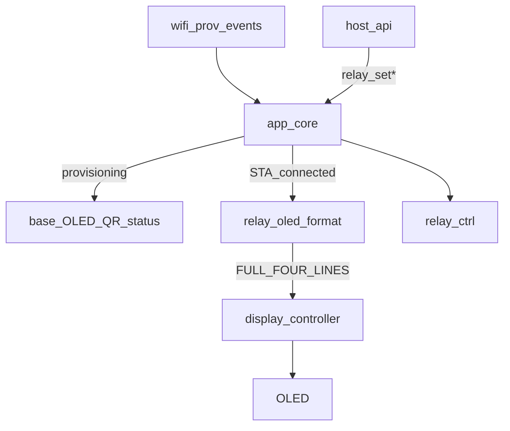

# Board Main Relay OLED Architecture — `b03_hil`

Normative particular architecture for the **main product OLED screen** that
shows mDNS identity and a **mode-stable** view of the six relays.

Source handoff: `agent-workspaces/architect/handoff.md`,
`B03_MAIN_RELAY_OLED`.

**View-mode binding for pulse / hold / train / encoder** (when to paint
`P`/`T`/`E`): see `docs/board_relay_oled_view_mode_architecture.md`
(`B03_RELAY_OLED_VIEW_MODE`). That doc **supersedes** any “tokens reserved /
product emits only 0/1” wording below once `relay_sched` is present.

All agentic development methodology documentation in this firmware tree is
maintained in English.

## Purpose

Define an implementation-ready contract so an independent implementer produces
substantially the same firmware behavior:

- Reuse shared HIL base pillars (WiFi onboarding, factory reset, mDNS identity,
  OLED delivery, error-LED WiFi link).
- While STA is connected, replace the base five-line `WIFI OK` screen with a
  four-line relay status screen.
- Line 0 shows `HIL-03-<MAC4>` (no `.local`).
- Lines 1–3 show channels `1`…`6` with aesthetic tokens `N:[X]` inside **square
  brackets**.
- Tokens reflect **channel mode / commanded stable state**, not raw electrical
  chatter from pulses, trains, or encoder-follow (LEDs already show fast
  switching).

## Related documents

| Document | Role |
| --- | --- |
| `docs/board_functional_description.md` | Product mission |
| `docs/board_hardware_description.md` | Pins, relays, OLED |
| `docs/board_relay_control_architecture.md` | `relay_ctrl` GPIO + OE |
| `docs/board_host_api_relay_architecture.md` | Host set/get (static on/off today) |
| `docs/board_product_architecture.md` | Bring-up / boot order |
| `docs/display_delivery_contract.md` | Only `app_core` → `display_controller_*` |
| `docs/oled_text_display_interface.md` | `FULL_FOUR_LINES`, MEDIUM width budget |
| `docs/device_discovery_mdns_architecture.md` | Hostname `HIL-03-<MAC4>` |
| `docs/wifi_provisioning_architecture.md` | Base provisioning / connected events |

## Normative language

`MUST` / `MUST NOT` / `SHOULD` / `MAY` follow RFC-style usage as in base OLED
and display-delivery docs.

## Scope

### In scope

- Particular main OLED layout and token grammar `N:[X]`.
- Channel **view mode** model (`0` / `1` / `P` / `T` / `E`) and mapping rules.
- `app_core` orchestration: STA connected → relay screen; provisioning UX stays
  base.
- Refresh policy (event-driven; no 1/0 flicker for dynamic modes).
- Minimal `relay_ctrl` (or `app_core`) view-mode state so static host commands
  update `0`/`1`, and future pulse/train/encoder handoffs can set `P`/`T`/`E`
  without changing the OLED grammar.

### Out of scope (this handoff)

- Implementing pulse / train / encoder **drivers** (tokens reserved only).
- Changing host API command names (still `relay_set*` / `relay_get*` for static
  on/off). Host fields for mode are a **future** handoff unless noted below.
- Particular graphics beyond ASCII text templates.
- Showing STA IPv4 / MAC on the connected OLED (removed in favor of relay view;
  identity remains SoftAP/mDNS + host `info`).
- NVS persistence of relay or view mode.
- Editing PCB / external channel LEDs firmware (hardware-driven from `KnDRV`).

## Human decisions frozen

1. Aesthetic token form is exactly `N:[X]` with **square brackets** (examples
   `1:[0]`, `2:[1]`, `3:[P]`).
2. Two channels per content line (width budget); three content lines cover six
   relays in **hardware column order**: left column `1→2→3` (top→bottom),
   right column `4→5→6` (top→bottom) — same cell grammar `N:[X]`, only the
   channel pairing per line changes vs a linear 1…6 reading order.
3. OLED shows **view mode**, not instantaneous coil voltage for dynamic modes.
4. Relay main screen is shown **only while WiFi STA is connected**.
5. SoftAP provisioning, connect-in-progress, connect-failure, and factory-reset
   UX remain **base** screens.

## Visibility rules

```text
Provisioning SoftAP / QR / connecting / failure / factory-reset UX
        →  base OLED templates (unchanged)

STA connected events (at least):
  WIFI_PROV_EVENT_SUBMITTED_SUCCESS
  WIFI_PROV_EVENT_SAVED_SUCCESS
  WIFI_PROV_EVENT_RUNTIME_RESTORED
  WIFI_PROV_EVENT_CONNECT_RESTORED
        →  show relay FULL_FOUR_LINES (not base FULL_FIVE_LINES WIFI OK)

STA lost / reconnecting (base link-down UX)
        →  stop pushing relay screen updates;
           follow base reconnect / error-LED OLED rules
```

Normative:

- On `b03_hil`, any function equivalent to base `show_wifi_connected_display()`
  **MUST NOT** call `DISPLAY_TEMPLATE_FULL_FIVE_LINES` with `WIFI OK` / IP /
  split MAC.
- It **MUST** show the relay layout defined in **Main OLED layout**.
- Relay display updates **MUST NOT** run during SoftAP provisioning.
- Enter the relay screen only when device identity `HIL-03-<MAC4>` is available
  (same SoftAP/mDNS string, without `.local`).

## Main OLED layout

Template: `DISPLAY_TEMPLATE_FULL_FOUR_LINES`.  
Font policy: **MEDIUM** (8 px glyph → max **16** printable ASCII characters per
full-width line; see `docs/oled_text_display_interface.md` § String width
budget).

```text
Line 0: HIL-03-<MAC4>           # mDNS / SoftAP identity; no ".local"
Line 1: 1:[0]  4:[1]            # left col ch1, right col ch4
Line 2: 2:[P]  5:[T]            # left col ch2, right col ch5
Line 3: 3:[E]  6:[0]            # left col ch3, right col ch6
```

Hardware-aligned columns (normative):

```text
        LEFT          RIGHT
Line1    1:[X]         4:[X]
Line2    2:[X]         5:[X]
Line3    3:[X]         6:[X]
```

### Line 0 — hostname

- Source: `device_identity` product hostname string (same as SoftAP SSID and
  mDNS hostname without `.local`).
- Example: `HIL-03-24CE` (11 characters ≤ 16).
- Printable ASCII only; no accents.

### Lines 1–3 — channel tokens (fixed columns)

Each channel cell is **exactly 5** characters:

```text
N:[X]
```

| Index in cell | Char | Rule |
| --- | --- | --- |
| 0 | `N` | Channel digit `1`…`6` |
| 1 | `:` | Literal ASCII colon |
| 2 | `[` | Literal ASCII left square bracket |
| 3 | `X` | View token (see table below) |
| 4 | `]` | Literal ASCII right square bracket |

Two cells per line, separated by **exactly two** ASCII spaces:

```text
Index:  0 1 2 3 4 5 6 7 8 9 10 11
        N : [ X ]   N : [  X  ]
Example: 1 : [ 0 ]   4 : [  1  ]
```

Exact 12-character line body (≤ 16):

```text
1:[0]  4:[1]
2:[P]  5:[T]
3:[E]  6:[0]
```

Rules:

- Line 1 **MUST** be channels **1** then **4** (left → right).
- Line 2 **MUST** be channels **2** then **5**.
- Line 3 **MUST** be channels **3** then **6**.
- Reading **down the left column** is `1`, `2`, `3`; **down the right column**
  is `4`, `5`, `6` (matches PCB/front-panel order).
- Separator between cells **MUST** be exactly two spaces (`0x20 0x20`).
- **MUST NOT** use the old linear pairing `1–2` / `3–4` / `5–6` on lines 1–3.
- **MUST NOT** put three `N:[X]` cells on one line (19+ characters; overflows
  MEDIUM budget).
- **MUST NOT** use round parentheses `()` or other bracket styles.
- **MUST NOT** omit the colon or brackets.
- No trailing spaces required to pad to 16; 12-character lines are valid.

### View token alphabet (`X`)

| `X` | Meaning | When used |
| --- | --- | --- |
| `0` | Stable commanded **off** | Static mode, coil commanded off |
| `1` | Stable commanded **on** | Static mode, coil commanded on |
| `P` | **Pulse** / one-shot / hold timer active | `relay_pulse`, `relay_hold`, `hold_many` — see view-mode binding doc |
| `T` | **Train** of pulses active | `encoder_pulse_train` |
| `E` | **Encoder** quadrature active | both channels of `encoder_step` |

Rules:

1. For **static** mode, `X` **MUST** be `0` or `1` matching the commanded shadow
   state from `relay_ctrl` (same as host `relay_get`).
2. For modes `P` / `T` / `E`, `X` **MUST** stay that letter for the whole time
   the mode is active. Firmware **MUST NOT** rewrite `X` to `0`/`1` on every
   electrical edge (that defeats the display purpose; external LEDs show edges).
3. With `relay_sched` / v2 host API present, product runtime **MUST** arm and
   clear `P`/`T`/`E` per
   `docs/board_relay_oled_view_mode_architecture.md`. Electrical edges use
   `relay_ctrl_drive*`; mode changes use `relay_ctrl_set_view_mode`.
4. Unknown / fault display token is **not** defined in this handoff; do not
   invent `?` unless a later architect doc adds it.

## View-mode model (software)

Normative enum names for this board (C):

```c
typedef enum {
    RELAY_VIEW_STATIC_OFF = 0, /* token '0' */
    RELAY_VIEW_STATIC_ON  = 1, /* token '1' */
    RELAY_VIEW_PULSE      = 2, /* token 'P' */
    RELAY_VIEW_TRAIN      = 3, /* token 'T' */
    RELAY_VIEW_ENCODER    = 4, /* token 'E' */
} relay_view_mode_t;
```

Mapping `relay_view_mode_t` → `X`:

| Enum | `X` |
| --- | --- |
| `RELAY_VIEW_STATIC_OFF` | `0` |
| `RELAY_VIEW_STATIC_ON` | `1` |
| `RELAY_VIEW_PULSE` | `P` |
| `RELAY_VIEW_TRAIN` | `T` |
| `RELAY_VIEW_ENCODER` | `E` |

Ownership:

- Preferred: extend `components/relay_ctrl/` with per-channel view mode +
  getters used by `app_core` formatting.
- Allowed: keep modes in `app_core` if `relay_ctrl` stays GPIO-only — then
  `app_core` **MUST** update modes whenever it applies `relay_ctrl_set*` for
  static commands, and keep modes consistent with shadow.

Static command coupling:

| Action | View mode result |
| --- | --- |
| `relay_ctrl_init` success | All six → `RELAY_VIEW_STATIC_OFF` |
| `relay_set` / `set_mask` channel on | That channel → `RELAY_VIEW_STATIC_ON` |
| `relay_set` / `set_mask` channel off | That channel → `RELAY_VIEW_STATIC_OFF` |

Dynamic sched coupling (`P`/`T`/`E`): **required** when `relay_sched` is
shipped — normative table in
`docs/board_relay_oled_view_mode_architecture.md`.

## Delivery path

```text
STA connected / relay_set* / set_mask
        --> app_core formats 4 lines
        --app_core_display_show_template(FULL_FOUR_LINES, lines, 4)-->
display_controller --> display task / OLED
```

- **Only `app_core`** MAY call `display_controller_*` / public
  `app_core_display_show_*` (base display delivery contract).
- `relay_ctrl` **MUST NOT** include display headers or call display APIs.
- `host_api` **MUST NOT** push OLED layouts; it changes relay state via
  `app_core_relay_*` / `relay_ctrl_*`, and `app_core` refreshes the screen when
  STA-connected.

## Refresh policy

| Trigger | Action |
| --- | --- |
| Enter STA connected (events listed above) | Build lines; one `FULL_FOUR_LINES` show |
| Any successful static set that changes a channel's view token | Rebuild lines; one show (if STA connected) |
| SoftAP / link-down / factory-reset UX | Do **not** keep pushing relay layout |
| Dynamic electrical edges under future `P`/`T`/`E` | **MUST NOT** alone refresh token `X` |

Rules:

- Prefer **event-driven** updates; a periodic 2 Hz loop is **not** required for
  static-only v1.
- Respect `DEFAULT_REFRESH_LIMIT_HZ = 10`.
- Idempotent re-show of the same four strings is allowed but SHOULD be avoided
  when nothing changed.

## Component boundaries



### `components/app_core/`

- Owns WiFi event → screen selection (base vs relay main).
- Formats the four ASCII lines per this doc.
- Calls
  `app_core_display_show_template(DISPLAY_TEMPLATE_FULL_FOUR_LINES, lines, 4)`.
- On static relay changes while STA connected, refreshes the relay screen.
- **MUST NOT** put GPIO bit-banging for relays outside `relay_ctrl`.

### `components/relay_ctrl/`

- Continues to own OE-safe GPIO and shadow mask
  (`docs/board_relay_control_architecture.md`, including
  `B03_RELAY_OE_LEVEL_BEFORE_DIR`).
- **SHOULD** own `relay_view_mode_t` per channel if that keeps host/OLED
  consistent; otherwise `app_core` owns modes with the coupling table above.

### `components/host_api/`

- Unchanged command names for this handoff.
- After set handlers return success, display refresh is `app_core`'s job (via
  facade that both sets relay and requests UI refresh, or wifi/display hook
  observing state — implementer choice, but acceptance requires OLED update
  without a reboot).

## Base pillars unchanged

Implementers **MUST** preserve base behavior for:

- WiFi provisioning SoftAP / HTTP portal / NVS credentials
- GPIO7 10 s factory reset
- mDNS hostname announcement on STA IPv4
- Error LED WiFi link mapping
- Display delivery: only `app_core` calls `display_controller_*`

Board number for identity is **`03`** → `HIL-03-<MAC4>`.

## Non-goals (recap)

- Pulse / train / encoder runtime (tokens reserved only)
- Flickering `0`/`1` for dynamic modes
- Three tokens per OLED line
- Base `WIFI OK` five-line screen while STA connected on this board
- `echo` / `loopback`

## Open questions (do not block this UI)

1. OLED I2C address `0x3C` vs `0x3D` on built hardware (probe both as base).
2. Exact pulse / train / encoder semantics — later handoffs; tokens already
   reserved.
3. Whether host `relay_get` later returns a `mode` field — not required to close
   this OLED handoff.

## Acceptance criteria

1. With STA connected, OLED shows exactly four lines: hostname without
   `.local`, then `1:[…]  4:[…]`, `2:[…]  5:[…]`, `3:[…]  6:[…]` with square
   brackets and two-space separators (12 characters on lines 1–3).
2. After `relay_set` channel 1 on (STA connected), line 1 left cell becomes
   `1:[1]` without requiring reboot; channel 4 remains the right cell of line 1.
3. After all-off, cells show `N:[0]` for every channel.
4. Channel 3 on updates line 3 left (`3:[1]`); channel 6 on updates line 3
   right (`6:[1]`) — not the old linear `5–6` pairing.
5. During SoftAP provisioning, base QR/status UX runs; relay screen **MUST
   NOT** appear.
6. SoftAP SSID, mDNS hostname, and OLED line 0 use the same `HIL-03-<MAC4>`
   string (no `.local` on OLED).
7. Only `app_core` calls display controller / `app_core_display_show_*` APIs.
8. `relay_ctrl` has no display includes.
9. Formatter supports tokens `0|1|P|T|E`. Static paths emit `0`/`1`; sched
   paths emit `P`/`T`/`E` per view-mode binding doc.
10. No continuous OLED update storm from electrical edges (event-driven on
    view-mode change, not on every `drive` edge).

## Validation notes (tester)

- Confirm each of lines 1–3 length is 12 (or ≤ 16) and matches the bracket
  aesthetic.
- Confirm provisioning QR → STA connect → relay four-line screen.
- Toggle channels via host API; OLED tokens track stable `0`/`1`; LEDs may be
  used as electrical confirmation.
- Confirm link-down / SoftAP return does not leave a stuck relay overlay.
