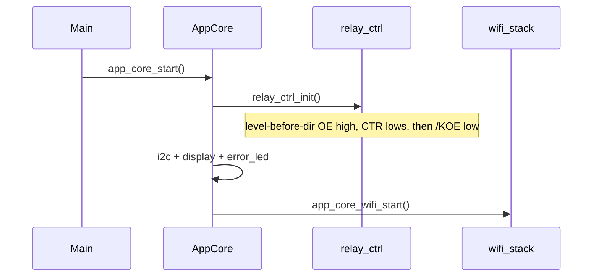

# Board Product Architecture — `b03_hil` Bring-Up

Normative particular architecture for the **first firmware implementation** of
`b03_hil`: adapt the `b00_basehil` reference tree, wire board identity and
pins, enable six relays safely, and expose relay host commands.

Source handoff: `agent-workspaces/architect/handoff.md`, `B03_PRODUCT_BRINGUP`
(depends on `B03_RELAY_CONTROL`, `B03_HOST_API_RELAY`).

All agentic development methodology documentation in this firmware tree is
maintained in English.

## Purpose

An independent implementer MUST be able to produce substantially the same
firmware without chat history by following this file plus:

| Document | Role |
| --- | --- |
| `docs/board_hardware_description.md` | Pins, OE path, connectors |
| `docs/board_functional_description.md` | Product mission |
| `docs/board_relay_control_architecture.md` | `relay_ctrl` API + OE sequence |
| `docs/board_host_api_relay_architecture.md` | Host command contracts |
| `docs/hil_base_reuse_contract.md` | No submodule; adapt-copy base |
| `docs/flash_partition_architecture.md` | 4 MB / large `factory` |
| Base pillar docs under `docs/` (working copies) | WiFi, mDNS, host API, display |

## Normative language

`MUST` / `MUST NOT` / `SHOULD` / `MAY` as in base docs.

## Scope

### In scope (this handoff)

1. Create a flashable ESP-IDF project under this `firmware/` tree by
   **adapt-copying** reference code from `b00_basehil/firmware` (no git
   submodule, no `EXTRA_COMPONENT_DIRS` into the base path).
2. Board identity `03` / `b03_hil` / `HIL-03-<MAC4>`.
3. Board pin constants matching `docs/board_hardware_description.md`.
4. Early `relay_ctrl` bring-up (OE-safe) before WiFi work continues.
5. Host API particular commands `relay_set`, `relay_set_all`, `relay_get`,
   `relay_get_all` (see relay host API doc).
6. Keep **base** OLED provisioning / connect / failure / factory-reset UX.
7. Adopt base `partitions.csv` + 4 MB flash defaults.

### Out of scope (this handoff)

- Particular OLED layout showing relay states (channel LEDs + host API only).
- NVS persistence of relay on/off across reboot (cold boot → all off).
- Streams, `echo`, `loopback` on this board.
- Changing family WiFi / discovery / host transport contracts.
- Editing `../pcb/`.
- Calibration, PWM, or timed pulse modes for relays.

## Human decisions frozen

1. **Code origin:** adapt-copy from `b00_basehil/firmware` into this tree.
2. **Relay cold state:** after `relay_ctrl_init`, all six channels are **off**
   and OE is **enabled** (buffer driving lows into ULN).
3. **No relay NVS** in v1.
4. **OLED:** unchanged base templates; no particular metering-style main screen.
5. **Host API board strings:** `board_id` = `b03_hil`, `board_number` = `03`.
6. **Do not** ship base demo commands `echo` / `loopback` on this board.

## Reference tree adapt-copy (deterministic)

### Copy from `b00_basehil/firmware` (include)

```text
CMakeLists.txt
sdkconfig.defaults
partitions.csv
main/
components/app_core/
components/board/
components/device_discovery/
components/device_identity/
components/display/
components/error_led/
components/host_api/
components/i2c_bus/
components/qr_encoder/
components/setup_url/
components/wifi_credentials/
components/wifi_provisioning/
dependencies.lock   (MAY regenerate via idf.py after first configure)
```

### Do not copy

```text
build/
sdkconfig          (regenerate; keep sdkconfig.defaults)
sdkconfig.old
managed_components/  (regenerate)
docs/                (already present; do not overwrite particular board_*.md)
agent-workspaces/    (already present)
```

### Mandatory renames / constant edits after copy

| Location | Change |
| --- | --- |
| Root `CMakeLists.txt` project name | `b03_hil_firmware` (or equivalent; must not stay `b00_basehil_*`) |
| `BOARD_HIL_NUMBER_STRING` | `"03"` |
| `board_name()` | return `"b03_hil"` |
| `HOST_API_BOARD_ID` / `HOST_API_BOARD_NUMBER` | `"b03_hil"` / `"03"` |
| Type name `b00_basehil_board_pins_t` | `b03_hil_board_pins_t` (or board-neutral `board_pins_t`) |
| Any log/string hard-coded `00` / `b00_basehil` for identity | board 03 |

Pin `#define`s MUST match the hardware description table (see relay + board
docs). Shared values that already match base and this PCB:

```text
BOARD_I2C_SCL_GPIO = GPIO0
BOARD_I2C_SDA_GPIO = GPIO1
BOARD_ERROR_LED_GPIO = GPIO8
BOARD_ERROR_LED_ACTIVE_LEVEL = 0
BOARD_FACTORY_RESET_GPIO = GPIO7
BOARD_FACTORY_RESET_ACTIVE_LEVEL = 0
BOARD_OLED_ADDRESS_0 = 0x3C
BOARD_OLED_ADDRESS_1 = 0x3D
```

## New / changed modules

| Path | Action |
| --- | --- |
| `components/relay_ctrl/` | **New** — see `docs/board_relay_control_architecture.md` |
| `components/board/` | Extend pins with OE + six CTR GPIOs |
| `components/app_core/app_core.c` | Call `relay_ctrl_init()` **before** I2C/display/WiFi |
| `components/app_core/` | Add thin `app_core_relay_*` facades used by host API |
| `components/host_api/` | Register four relay commands; update capabilities; drop echo/loopback |

Exact public C APIs: relay control + host API architecture docs (normative).

## Boot / startup order (normative)

`main/app_main.c` remains thin and only calls `app_core_start()`.

Inside `app_core_start()` the order **MUST** be:

```text
1. Log board_name()
2. relay_ctrl_init()          /* OE-safe GPIO; BEFORE any long init */
3. board_i2c_bus_config + i2c_bus_init
4. display geometry / setup_url self-tests (as in base)
5. display_start + display_controller_init
6. error_led_init
7. app_core_wifi_start()      /* provisioning / STA / discovery / host API */
```

Rules:

- Step 2 **MUST** complete successfully before step 3. If `relay_ctrl_init`
  fails, `app_core_start` **MUST** treat it as fatal (`ESP_ERROR_CHECK` or
  equivalent abort) — running WiFi with an unsafe relay path is forbidden.
- Host API becomes reachable only under base rules (STA + IPv4). Relays may be
  driven locally via `relay_ctrl_*` as soon as init succeeds; remote control
  waits for host API up.
- Factory-reset and WiFi behavior remain base contracts.



## Flash / build config

| Item | Value |
| --- | --- |
| Target | `esp32c3` |
| Flash size | `4MB` via `sdkconfig.defaults` |
| Partitions | copy base `partitions.csv` unchanged |
| `CONFIG_ESPTOOLPY_FLASHSIZE` | `4MB` |
| Custom partition table | enabled as in base defaults |

## Non-goals (recap)

- Submodule / live path dependency on `b00_basehil`
- Particular relay OLED screen in this handoff
- Persisted relay state
- Competing host protocol

## Open questions

1. Confirm physical flash is 4 MB on production SuperMini modules used with
   `b03` (expected yes).
2. OLED address on assembled boards (`0x3C` vs `0x3D` — probe both as base).
3. Strapping interactions on `GPIO2` / `GPIO8` / `GPIO9` — validate on hardware;
   hardware description already notes them.
4. Power-cycle relay glitch: closed by `B03_RELAY_OE_LEVEL_BEFORE_DIR` in
   `docs/board_relay_control_architecture.md` (tester RCA 2026-11-03). Retest
   after implementer patch; further UART remux work only if chatter remains.

## Acceptance criteria (product bring-up)

1. Project builds for `esp32c3` with 4 MB flash and base-sized `factory`
   partition.
2. SoftAP identity and mDNS hostname use `HIL-03-<MAC4>` (not `00`).
3. `info.board_id` / `board_number` are `b03_hil` / `03`.
4. Within `app_core_start`, `relay_ctrl_init` runs before I2C/WiFi.
5. After boot, all relays are off (contacts not energized) until a host command
   turns a channel on.
6. Base WiFi provisioning + factory reset + error LED contracts still work.
7. `capabilities` lists mandatory base commands plus the four relay commands;
   no `echo` / `loopback`.
8. No build-time dependency path into `b00_basehil`.
9. Power-cycle: no short relay oscillation from OE GPIO bring-up
   (`B03_RELAY_OE_LEVEL_BEFORE_DIR`).

## Validation notes (tester)

- Scope for this handoff spans relay OE, WiFi onboarding, and host relay
  commands — see also acceptance sections in the two sibling architecture
  docs.
- Prefer scoping `/KOE` or human-ear power-cycle check after any
  `relay_ctrl_init` change (see relay control acceptance #10).
