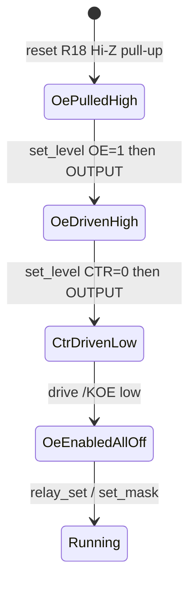

# Board Relay Control Architecture — `b03_hil`

Normative particular architecture for **safe six-channel relay GPIO control**
on `b03_hil` (buffer OE + ULN path).

Source handoff: `agent-workspaces/architect/handoff.md`, `B03_RELAY_CONTROL`
(extension `B03_RELAY_OE_LEVEL_BEFORE_DIR` — power-cycle glitch RCA from
tester, 2026-11-03).

All agentic development methodology documentation in this firmware tree is
maintained in English.

## Purpose

Freeze module boundaries, pin constants, boot OE sequence, channel numbering,
public C API, concurrency, and failure rules so an implementer does not invent
alternate structures for the same hardware.

Hardware authority: `docs/board_hardware_description.md` (PCB pinfunction).

## Related documents

| Document | Role |
| --- | --- |
| `docs/board_hardware_description.md` | GPIO map, `/KOE`, ULN, J2 |
| `docs/board_product_architecture.md` | When init runs in boot |
| `docs/board_host_api_relay_architecture.md` | HTTP commands over this API |
| `docs/board_functional_description.md` | Product intent |

## Normative language

`MUST` / `MUST NOT` / `SHOULD` / `MAY` as in base docs.

## Scope

### In scope

- New component `components/relay_ctrl/`
- Board pin symbols for OE + six CTR lines
- Boot and runtime OE/CTR rules
- Software shadow state for channel on/off
- Thread-safe set/get used by `app_core` / host API

### Out of scope

- Host JSON schemas (sibling doc)
- OLED layouts
- Driving `KnDRV` GPIOs directly (those nets are **not** MCU pins)
- Pulse / interlock / mutual-exclusion matrices between channels
- Reading back coil or contact sense (no sense HW on MCU)

## Channel numbering (canonical)

| `channel` (int) | Silk / logical | MCU CTR GPIO | Net |
| --- | --- | --- | --- |
| `1` | K1 | `GPIO21` | `K1CTR` |
| `2` | K2 | `GPIO9` | `K2CTR` |
| `3` | K3 | `GPIO3` | `K3CTR` |
| `4` | K4 | `GPIO4` | `K4CTR` |
| `5` | K5 | `GPIO10` | `K5CTR` |
| `6` | K6 | `GPIO20` | `K6CTR` |

Rules:

- Host API, logs, and C APIs **MUST** use channels `1`…`6` only.
- Mask bit `(channel - 1)` corresponds to that channel (`bit0` = ch1 … `bit5` = ch6).
- Valid mask range: `0`…`63` (`0x3F`). Bits 6–7 **MUST** be rejected if set on
  input; on output they **MUST** be zero.

## Electrical / logical polarity

| Signal | Active meaning | GPIO level when active |
| --- | --- | --- |
| `/KOE` (`BOARD_RELAY_OE_GPIO`) | Buffer **enabled** | **0** (active-low) |
| `KnCTR` | Relay **commanded on** (after OE enabled) | **1** |

Path reminder:

```text
KnCTR --U8--> KnDRV --ULN2003--> coil (A1 sink, A2=+3V3)
```

With OE disabled (`/KOE` = 1, pull-up `R18`), `U8` outputs are Hi-Z; relays
MUST be treated as unsafe to assume until OE is enabled with CTR lows.

### Power-cycle hazard (observed)

Tester RCA (`agent-workspaces/tester/handoff.md`, 2026-11-03): human heard a
**very short** relay chatter on power cycle / reset. Root cause was firmware
calling `gpio_config(..., GPIO_MODE_OUTPUT)` on `/KOE` **before** latching the
inactive OUT level.

On ESP32-C3, enabling a GPIO as output applies the current OUT register bit.
That bit defaults to **0**. Because `/KOE` is **active-low**, OUT=0 means
**OE enabled** for a window while `KnCTR` are still inputs / UART / floating →
brief `KnDRV` pulses → coil clicks. Then firmware wrote OE high (disabled)
again and continued — matching a *muy corta* oscillation.

Contributing: `GPIO21` / `GPIO20` (`K1CTR` / `K6CTR`) are default UART0 TX/RX;
console activity can appear on buffer inputs if OE is accidentally enabled
early.

**Normative consequence:** every relay GPIO bring-up step MUST use
**level-before-direction** (see init sequence). Wording of the form “configure
as OUTPUT, then drive inactive” is **forbidden** — that order is the bug.

## Pin constants (`components/board`)

`board_pins.h` **MUST** define (exact names):

```c
#define BOARD_RELAY_OE_GPIO            GPIO_NUM_2
#define BOARD_RELAY_OE_ACTIVE_LEVEL    0

#define BOARD_RELAY1_CTR_GPIO          GPIO_NUM_21
#define BOARD_RELAY2_CTR_GPIO          GPIO_NUM_9
#define BOARD_RELAY3_CTR_GPIO          GPIO_NUM_3
#define BOARD_RELAY4_CTR_GPIO          GPIO_NUM_4
#define BOARD_RELAY5_CTR_GPIO          GPIO_NUM_10
#define BOARD_RELAY6_CTR_GPIO          GPIO_NUM_20

#define BOARD_RELAY_CTR_ACTIVE_LEVEL   1
#define BOARD_RELAY_CHANNEL_COUNT      6
```

`board_pins()` **MAY** expose these in a struct; if so, field names SHOULD be
`relay_oe`, `relay_ctr[6]` (index 0 = channel 1). Macros above remain
normative even if the struct exists.

Unused MCU pads `GPIO5` / `GPIO6` **MUST NOT** be claimed as relay pins.

## Component `relay_ctrl`

### Files (required)

```text
components/relay_ctrl/
  CMakeLists.txt
  include/relay_ctrl.h
  relay_ctrl.c
```

`CMakeLists.txt` **MUST** require `board`, `driver`, `freertos` (or equivalent
ESP-IDF components needed for GPIO + mutex). **MUST NOT** depend on
`host_api`, `display`, or `wifi_provisioning`.

### Public API (normative signatures)

```c
#pragma once
#include <stdbool.h>
#include <stdint.h>
#include "esp_err.h"

#define RELAY_CTRL_CHANNEL_MIN 1
#define RELAY_CTRL_CHANNEL_MAX 6
#define RELAY_CTRL_MASK_ALL    0x3Fu

esp_err_t relay_ctrl_init(void);

esp_err_t relay_ctrl_set(int channel, bool on);
esp_err_t relay_ctrl_set_mask(uint8_t mask);
esp_err_t relay_ctrl_get(int channel, bool *on_out);
uint8_t   relay_ctrl_get_mask(void);
bool      relay_ctrl_is_output_enabled(void);
```

Semantics:

| Function | Behavior |
| --- | --- |
| `relay_ctrl_init` | Performs OE sequence below; idempotent (`ESP_OK` if already inited) |
| `relay_ctrl_set` | Set one channel `1`…`6`; updates GPIO + shadow; `ESP_ERR_INVALID_ARG` if channel out of range or not inited |
| `relay_ctrl_set_mask` | Set all six from mask; `ESP_ERR_INVALID_ARG` if `(mask & ~0x3F) != 0` or not inited |
| `relay_ctrl_get` | Read **software shadow** (not contact sense); `ESP_ERR_INVALID_ARG` if bad channel / NULL / not inited |
| `relay_ctrl_get_mask` | Shadow mask; returns `0` if not inited |
| `relay_ctrl_is_output_enabled` | `true` iff OE GPIO is at active level after successful init |

### Normative init sequence (`relay_ctrl_init`)

Implementer **MUST** execute in this order. The critical rule is
**level-before-direction**: latch the desired OUT level **before** the pad is
switched to push-pull output, so ESP-IDF never drives the default OUT=0.

```text
1. Take internal mutex (create if needed).

2. Preload OE inactive in the OUT register, THEN enable OE as output:
   a. gpio_set_level(BOARD_RELAY_OE_GPIO, inactive)   /* inactive = logical 1 */
      — allowed while the pin is still input/Hi-Z; latches the OUT bit only.
   b. gpio_config / gpio_set_direction → GPIO_MODE_OUTPUT on OE.
   c. After step 2b the pad MUST drive /KOE high (OE disabled). R18 alone is
      not sufficient once the MCU claims the pad.

3. For each CTR GPIO (channels 1..6), same rule:
   a. gpio_set_level(CTR, inactive)   /* inactive = logical 0 = relay off */
   b. Then configure that pin as GPIO_MODE_OUTPUT.
   Prefer doing (a) for all six, then (b) for all six, or (a)+(b) per pin;
   either is OK if no CTR becomes an output while its OUT bit is still 1
   and OE is still disabled (OE MUST already be driving inactive from step 2).

4. Clear software shadow mask to 0 (all off). Re-assert all CTR levels = 0
   after they are outputs (belt and suspenders).

5. Only now drive OE GPIO to ACTIVE level (logical 0) — enable buffer.

6. Mark module initialized; release mutex.

7. Return ESP_OK.
```

Equivalent ESP-IDF sketch (normative intent, not a literal required helper):

```c
/* OE: inactive BEFORE output enable */
gpio_set_level(BOARD_RELAY_OE_GPIO, /* inactive */ 1);
gpio_set_direction(BOARD_RELAY_OE_GPIO, GPIO_MODE_OUTPUT);
/* CTR: off BEFORE output enable */
for (each ctr) {
    gpio_set_level(ctr, /* inactive */ 0);
    gpio_set_direction(ctr, GPIO_MODE_OUTPUT);
}
/* Enable buffer only with all CTR cold */
gpio_set_level(BOARD_RELAY_OE_GPIO, /* active */ 0);
```



Forbidden:

- Calling `gpio_config(..., OUTPUT)` or `gpio_set_direction(OUTPUT)` on OE
  **before** `gpio_set_level(OE, inactive)`.
- Calling output-enable on any CTR **before** `gpio_set_level(CTR, inactive)`.
- Enabling OE (active low) while any CTR pin is still an input, UART, or
  floating, or while any CTR is driven high.
- Relying only on `R18` after the MCU has claimed the OE pad.
- Wording or code that does “`gpio_config` then `gpio_set_level`” for OE/CTR
  bring-up.

GPIO config details:

- Use `GPIO_MODE_OUTPUT` (push-pull) after the level preload.
- `gpio_set_level` before direction change is the required preload; do **not**
  skip it because the pin “is not an output yet”.
- No internal pull-up/down required on CTR once they are outputs.
- On OE pin, external `R18` remains until the MCU drives the pad; after step 2
  the MCU **MUST** hold inactive high until step 5.

### Runtime set rules

After init:

1. `relay_ctrl_set(channel, true)` drives that CTR GPIO to
   `BOARD_RELAY_CTR_ACTIVE_LEVEL` (1) and sets the shadow bit.
2. `relay_ctrl_set(channel, false)` drives CTR to 0 and clears the shadow bit.
3. `relay_ctrl_set_mask(mask)` applies all six CTR levels to match the mask in
   one critical section (mutex held); shadow becomes `mask & 0x3F`.
4. OE **MUST** remain enabled for the life of normal product operation in v1.
   There is **no** public `relay_ctrl_disable_oe()` in this handoff.
5. All public set/get functions except `relay_ctrl_get_mask` /
   `relay_ctrl_is_output_enabled` documentation cases **MUST** lock the same
   mutex. `get_mask` / `is_output_enabled` **MUST** also be race-free (mutex or
   atomic snapshot).

### `app_core` facade (required)

`app_core` **MUST** expose thin wrappers so `host_api` does not include
`relay_ctrl.h` if the board prefers a single facade (either pattern is allowed,
but **one** of these is required):

**Option A (preferred):** host_api calls `app_core_relay_*` only.

```c
esp_err_t app_core_relay_set(int channel, bool on);
esp_err_t app_core_relay_set_mask(uint8_t mask);
esp_err_t app_core_relay_get(int channel, bool *on_out);
uint8_t   app_core_relay_get_mask(void);
```

These **MUST** map 1:1 to `relay_ctrl_*`.

**Option B:** host_api calls `relay_ctrl_*` directly and `app_core` only calls
`relay_ctrl_init` at boot.

Do **not** mix both call styles for sets in different modules without mutex —
`relay_ctrl` mutex covers that if all go through `relay_ctrl_*`.

## Persistence

v1 **MUST NOT** store relay state in NVS. Every boot ends init with all channels
off.

## Logging

- `ESP_LOGI` once on successful init: OE enabled, mask=0x00.
- `ESP_LOGD` or `I` on each set is optional; if logged, include channel and on.

## Non-goals

- Contact feedback / coil current sense
- Disabling OE at runtime as a product feature
- Per-channel hardware interlocks

## Open questions

- BOM resistor values do not change GPIO API.
- Residual boot chatter after level-before-direction fix: if still audible,
  architect may authorize UART0 remux timing or earlier init; **not** authorized
  until retest fails.

## Acceptance criteria

1. `components/relay_ctrl/` exists with API signatures above.
2. Init matches the level-before-direction sequence; source **MUST NOT** call
   `gpio_config`/`gpio_set_direction(OUTPUT)` on OE or any CTR before the
   matching inactive `gpio_set_level`.
3. After init, `relay_ctrl_get_mask() == 0` and `relay_ctrl_is_output_enabled()
   == true`.
4. `relay_ctrl_set(1, true)` energizes only K1 path (CTR GPIO21 high); others
   remain off.
5. `relay_ctrl_set_mask(0x15)` yields channels 1,3,5 on (`bits 0,2,4`).
6. Invalid channel `0` or `7` returns `ESP_ERR_INVALID_ARG` without changing
   state.
7. Mask `0x40` returns `ESP_ERR_INVALID_ARG`.
8. Component has no WiFi/HTTP/display includes.
9. Called from `app_core_start` before I2C/WiFi per product architecture.
10. **Power-cycle / reset:** no audible short relay chatter attributable to
    `relay_ctrl_init` OE glitch (human ear or scope on `/KOE` / `KnDRV`).
    Criteria: `/KOE` must not be driven low by the MCU until all CTR are
    outputs held inactive.

## Validation notes (tester)

- Visual: `D1`…`D6` track drive assertion when corresponding channel is on.
- Power-cycle: listen for the previously reported *muy corta* oscilación; after
  the OE fix it **MUST** be gone. Optional: scope `/KOE` — must stay high from
  reset through CTR output enable, then fall once when OE is intentionally
  activated with mask=0.
- Note UART0 default on `GPIO20`/`GPIO21` if any residual chatter remains after
  the level-before-direction patch.
