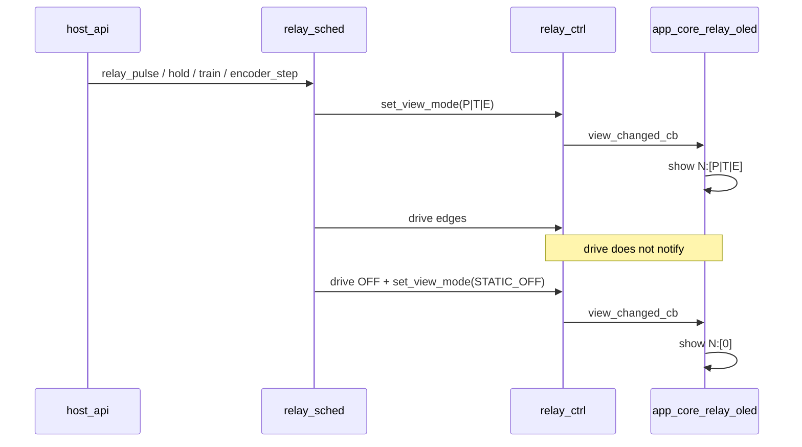

# Board Relay OLED View-Mode Binding — `b03_hil`

Normative particular architecture that **arms and clears** OLED view tokens
`P` / `T` / `E` (and returns to `0` / `1`) when `relay_sched` timed / encoder
actions run.

Source handoff: `agent-workspaces/architect/handoff.md`,
`B03_RELAY_OLED_VIEW_MODE`.

Supersedes the “`P`/`T`/`E` reserved — product emits only `0`/`1`” rule in
`docs/board_main_relay_oled_architecture.md` for boards that ship
`B03_HOST_API_RELAY_V2_LLM` / `relay_sched`.

Layout grammar `N:[X]` remains
`docs/board_main_relay_oled_architecture.md`.  
GPIO / `drive` vs `set`:
`docs/board_relay_control_architecture.md`.  
Host timed commands:
`docs/board_host_api_relay_v2_architecture.md`.

All agentic development methodology documentation in this firmware tree is
maintained in English.

## Purpose

Tester confirmed (2026-11-03): during `relay_pulse` / hold / pulse-train /
encoder electrical activity, OLED stayed at `N:[0]` while LEDs/clicks changed.
Root cause under the old OLED v1 contract: `relay_sched` calls
`relay_ctrl_drive*` (GPIO only) and never sets view mode / never notifies OLED.

This handoff makes dynamic tokens **product-required** and freezes:

- Which sched action → which token
- When to arm / clear mode
- That electrical edges still use `drive*` (no `0`/`1` flicker)
- Exact `relay_ctrl` APIs implementers must add/use
- OLED refresh triggers

## Normative language

`MUST` / `MUST NOT` / `SHOULD` / `MAY` as in base docs.

## Scope

### In scope

- Binding `relay_sched` lifecycle → `relay_view_mode_t` → OLED `N:[X]`
- `relay_ctrl_set_view_mode` (+ notify existing view-changed callback)
- Clear rules on natural end, cancel, preempt by static `relay_set*`

### Out of scope

- Changing OLED line layout / bracket aesthetic
- Changing v2 host command names or timing limits
- New token letters (no `H` for hold — hold uses `P`)
- Driving display from `relay_sched` or `host_api` directly

## Token meaning (product, not reserved)

| `X` | Enum | Meaning on OLED |
| --- | --- | --- |
| `0` | `RELAY_VIEW_STATIC_OFF` | Stable static off |
| `1` | `RELAY_VIEW_STATIC_ON` | Stable static on |
| `P` | `RELAY_VIEW_PULSE` | One-shot / timed program on that channel (`relay_pulse`, `relay_hold`, `relay_hold_many` item) |
| `T` | `RELAY_VIEW_TRAIN` | Single-channel pulse train running (`encoder_pulse_train`) |
| `E` | `RELAY_VIEW_ENCODER` | Channel participates in active quadrature `encoder_step` |

Rules:

1. While `P` / `T` / `E` is shown, electrical ON/OFF edges **MUST** use
   `relay_ctrl_drive` / `drive_mask` and **MUST NOT** call `relay_ctrl_set` /
   `set_mask` (those flip view to `0`/`1`).
2. Token `X` **MUST NOT** toggle on each coil edge; it stays the mode letter
   until the program ends or is preempted.
3. External channel LEDs remain the fast electrical indicator.

## Required `relay_ctrl` API addition

`components/relay_ctrl/include/relay_ctrl.h` **MUST** expose:

```c
/**
 * Set OLED/view mode for channel 1..6 without changing GPIO.
 * If mode differs from current, update storage and invoke the view-changed
 * callback (same callback used by relay_ctrl_set*).
 */
esp_err_t relay_ctrl_set_view_mode(int channel, relay_view_mode_t mode);
```

Semantics:

| Case | Result |
| --- | --- |
| channel not in 1..6 | `ESP_ERR_INVALID_ARG` |
| not initialized | `ESP_ERR_INVALID_ARG` |
| mode unchanged | `ESP_OK`, **no** callback |
| mode changed | store; invoke `relay_ctrl_set_view_changed_callback` listener once; `ESP_OK` |

`relay_ctrl_drive` / `drive_mask` **MUST** continue to:

- update GPIO + electrical shadow as today
- **MUST NOT** change view mode
- **MUST NOT** invoke the view-changed callback

`relay_ctrl_set` / `set_mask` **MUST** continue to set `STATIC_ON` / `STATIC_OFF`
and notify on token change (preempt path).

Comments on `RELAY_VIEW_PULSE` / `TRAIN` / `ENCODER` in the header **MUST NOT**
say “reserved” after this handoff.

## Binding table (`relay_sched` → view mode)

### One-shot timers (`P`)

Applies to shared arming path used by:

- `relay_sched_pulse`
- `relay_sched_hold`
- each item of `relay_sched_hold_many`

| Event | View mode action | GPIO |
| --- | --- | --- |
| Arm success (channel starts timed ON) | `relay_ctrl_set_view_mode(ch, RELAY_VIEW_PULSE)` **before or immediately after** first drive ON | `relay_ctrl_drive(ch, true)` |
| Natural timer expiry (auto OFF) | `drive(ch, false)` then `set_view_mode(ch, RELAY_VIEW_STATIC_OFF)` | OFF |
| `relay_sched_cancel` / `cancel_all` for that channel | same as natural end → `STATIC_OFF` | OFF |
| Re-arm same channel (replace timer) | keep or re-set `RELAY_VIEW_PULSE` (callback only if changed — usually no-op) | restart ON + timer |

Order on arm (normative):

```text
1. Preempt any encoder that uses this channel (existing sched rules)
2. set_view_mode(ch, PULSE)     /* OLED shows P even if already electrically off */
3. drive(ch, true)
4. arm esp_timer release
```

Order on release / cancel:

```text
1. drive(ch, false)
2. set_view_mode(ch, STATIC_OFF)
```

### Pulse train (`T`)

`relay_sched_encoder_pulse_train(channel, …)`:

| Event | View mode |
| --- | --- |
| Run starts | `set_view_mode(channel, RELAY_VIEW_TRAIN)` once |
| Each ON/OFF edge inside the train | `drive` only — **no** view change |
| Run completes / `encoder_cancel` / preempt | `drive(channel, false)` then `set_view_mode(channel, STATIC_OFF)` |

### Quadrature encoder (`E`)

`relay_sched_encoder_step(channel_a, channel_b, …)`:

| Event | View mode |
| --- | --- |
| Run starts | `set_view_mode(channel_a, ENCODER)` and `set_view_mode(channel_b, ENCODER)` |
| Phase advances | `drive` on A/B only — **no** view change |
| Run completes / cancel / preempt of either channel | both channels: `drive` false as today, then both `STATIC_OFF` |

If a channel is only lightly touched by abort paths, still clear **both** A and B
to `STATIC_OFF` when the encoder run ends.

### Static preempt (existing)

| Event | View mode |
| --- | --- |
| `relay_set` / `set_mask` / `release_all` via `relay_ctrl_set*` | Existing static `0`/`1` update + notify |
| Sched preempt before static set | Sched **MUST** clear dynamic mode (`STATIC_OFF`) on affected channels **or** rely on the following `relay_ctrl_set*` to overwrite view — prefer explicit `set_view_mode` to `STATIC_OFF` then let `set` apply `0`/`1`, **or** only `set*` if it always runs. Normative: after preempt+static set, final token **MUST** match static shadow (`0`/`1`). |

Recommended preempt order when host calls `relay_set` during pulse:

```text
relay_sched_preempt_channel(ch)  /* stop timer; drive off; set_view_mode STATIC_OFF */
relay_ctrl_set(ch, on)           /* STATIC_ON/OFF + notify */
```

If current code preempts inside `relay_ctrl_set` path, ensure view ends as
`STATIC_ON`/`OFF` and OLED refreshes once.

## OLED refresh

Existing path **MUST** remain:

```text
relay_ctrl view-changed callback
    --> app_core_relay_oled listener
    --> if STA relay OLED active: app_core_relay_oled_show()
```

Therefore:

- `relay_sched` **MUST NOT** call display APIs.
- `relay_sched` **MUST** call `relay_ctrl_set_view_mode` so the callback fires.
- If STA OLED is inactive (SoftAP / link-down), mode still updates in
  `relay_ctrl` (so the next STA screen is correct); show is skipped by the
  existing active flag.

## Module ownership

| Module | Must | Must not |
| --- | --- | --- |
| `relay_ctrl` | `set_view_mode`; keep `drive` view-inert; callback | Know sched or HTTP |
| `relay_sched` | Arm/clear modes per binding table; use `drive` for edges | Include display / `app_core` OLED headers |
| `app_core` OLED | Format `N:[X]` from `get_view_mode`; refresh on callback | Parse sched timers |
| `host_api` | Call `app_core` / sched facades only | Set view modes itself |



## Relationship to prior OLED doc

Update in force:

| Old rule (`B03_MAIN_RELAY_OLED`) | New rule |
| --- | --- |
| Product runtime **MUST** only emit `0`/`1` | Product **MUST** emit `P`/`T`/`E` while sched programs are active |
| Setting `P`/`T`/`E` forbidden until later handoff | This handoff **is** that authorization for `relay_sched` |

Unchanged: layout, brackets, two channels per line, STA-only visibility,
no flicker of `0`/`1` on dynamic edges.

## Acceptance criteria

1. With STA connected, `relay_pulse` on channel 1 → OLED shows `1:[P]` within
   one display refresh after arm (before pulse ends), not `1:[0]` for the whole
   pulse if the channel was off.
2. During the pulse, coil/LED may blink or stay on; OLED token stays `P` (no
   alternation `P`↔`0`/`1` on edges).
3. When pulse ends, OLED shows `1:[0]` (assuming release to off).
4. `relay_hold` / `hold_many` armed channels show `P` until release/cancel.
5. `encoder_pulse_train` on channel 5 → `5:[T]` for the run; then `5:[0]`.
6. `encoder_step` on channels 3 and 4 → `3:[E]` and `4:[E]` for the run; then
   both `0` (if left off).
7. `relay_set` channel 2 on during/after activity → `2:[1]` (static).
8. `relay_ctrl_drive` never alone changes OLED tokens.
9. `relay_sched` has no display includes.
10. SoftAP / non-STA: no requirement to paint OLED; modes still stored correctly.

## Validation notes (tester)

- Slow: pulse 2–4 s per channel; confirm `P` appears and clears.
- Hold 6 s: `P` for duration; then `0`.
- Train: `T` stable during blinks.
- Encoder step: both channels `E` until done.
- Static walk still shows `0`/`1` live refresh.

## Non-goals

- Host JSON `mode` field (optional later)
- Distinct hold token
- Changing MEDIUM width layout
