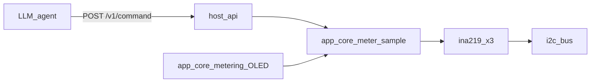

# Board Host API Metering Architecture — `b06_hil`

Normative particular architecture for **remote metering commands** on
`b06_hil` over the family host API (`POST /v1/command`).

Source handoff: `agent-workspaces/architect/handoff.md`,
`B06_HOST_API_METERING`.

All agentic development methodology documentation in this firmware tree is
maintained in English.

## Purpose

Give an LLM agent (primary client) a deterministic way to read per-output bus
voltage, current, and power for silk channels OUT 1 / 2 / 3 after discovering
the board on the LAN.

This document freezes command names, args, result fields, units, errors,
`capabilities` catalog entries, and module boundaries so an independent
implementer produces substantially the same behavior.

## Related documents

| Document | Role |
| --- | --- |
| `docs/external_host_api_architecture.md` | Family transport, errors, when API is up |
| `docs/external_host_command_api.md` | `POST /v1/command` envelope |
| `docs/external_host_stream_api.md` | Streams (none for metering v1) |
| `docs/board_host_api_extensions.md` | Human checklist; points here |
| `docs/board_hardware_description.md` | Silk ↔ INA219 address map |
| `docs/board_main_metering_oled_architecture.md` | OLED path (separate; shared INA219) |
| `docs/i2c_bus_architecture.md` | Shared I2C / optional broker |

## Normative language

`MUST` / `MUST NOT` / `SHOULD` / `MAY` follow RFC-style usage as in base host
API docs.

## Scope

### In scope

- Two particular commands: `meter_read`, `meter_read_all`.
- SI units in field names: volts (`_v`), amperes (`_a`), watts (`_w`).
- Channel index = **PCB silkscreen** OUT 1 / 2 / 3.
- Fresh I2C samples for each command (not OLED display string reuse).
- Updates to on-device `capabilities` manifest and `info` (no particular
  extra `info` keys required in this handoff).
- Serialization with the OLED metering loop when both are present.

### Out of scope

- Particular binary streams / continuous sample streaming.
- SoftAP-portal metering (host API only on STA + IPv4).
- Changing family `/v1` paths, Base64 limits, or mandatory
  `ping` / `info` / `capabilities`.
- Re-adding base demo `echo` / `loopback` on this board.
- Calibration commands or NVS shunt programming.
- Authentication / HTTPS.

## Transport (unchanged family rules)

```text
POST http://HIL-06-<MAC4>.local/v1/command
Content-Type: application/json
```

Envelope: `docs/external_host_command_api.md`.  
Host API active only when STA has IPv4 and SoftAP portal httpd is not on
port 80 (`docs/external_host_api_architecture.md`).

Handler timeout remains **5000 ms**. Metering handlers **MUST** complete well
under that budget (three INA219 reads are expected to finish in tens of ms).

## Channel map (canonical)

| `channel` (int) | Silk | INA219 | I2C addr |
| --- | --- | --- | --- |
| `1` | OUT 1 | U3 | `0x42` |
| `2` | OUT 2 | U2 | `0x41` |
| `3` | OUT 3 | U1 | `0x40` |

Rules:

- Agents and firmware **MUST** use silk numbers only.
- Mapping by schematic `OUT_PW_LED*` numerals is **forbidden**.

## Units and sample semantics

| Result field | Unit | Meaning |
| --- | --- | --- |
| `voltage_v` | volt | INA219 bus voltage |
| `current_a` | ampere | Signed shunt current (negative allowed) |
| `power_w` | watt | Instantaneous power for that sample |

Normative power rule for this handoff:

```text
power_w = voltage_v * current_a
```

computed from the **same** voltage and current sample used in the response
(software product). Firmware **MAY** also read the INA219 power register for
internal checks, but the JSON `power_w` value **MUST** equal `voltage_v *
current_a` within ordinary float rounding (so agents can verify consistency).

JSON types:

- `channel`: JSON number (integer value `1`, `2`, or `3`)
- `ok`: JSON boolean
- `voltage_v`, `current_a`, `power_w`: JSON numbers (IEEE-754 float serialized
  as JSON number; no unit strings)

Display clamp rules from the OLED architecture **do not** apply to host API
numeric fields (full float as read / computed, aside from I2C failure).

## Shared channel result object

Used inside both commands:

```json
{
  "channel": 1,
  "ok": true,
  "voltage_v": 5.01,
  "current_a": 0.12,
  "power_w": 0.6012
}
```

When the channel sample fails (I2C / driver error):

```json
{
  "channel": 1,
  "ok": false
}
```

Rules:

- On `ok: true`, `voltage_v`, `current_a`, and `power_w` **MUST** all be
  present as numbers.
- On `ok: false`, those three fields **MUST** be omitted.
- Outer HTTP envelope remains `"ok": true` when the command itself is valid,
  even if one or more channels report `"ok": false` (soft per-channel failure).
- Invalid args still use outer `"ok": false` with `error.code` (hard failure).

## Command: `meter_read`

Read **one** silk channel.

### Request

```json
{
  "id": "m1",
  "name": "meter_read",
  "args": { "channel": 1 }
}
```

| Args field | Type | Required | Rules |
| --- | --- | --- | --- |
| `channel` | int | Yes | Exactly `1`, `2`, or `3` |

### Success

```json
{
  "ok": true,
  "id": "m1",
  "api_version": 1,
  "result": {
    "channel": 1,
    "ok": true,
    "voltage_v": 5.01,
    "current_a": 0.12,
    "power_w": 0.6012
  }
}
```

`result` **MUST** be exactly one shared channel result object (fields above).

### Errors (outer envelope)

| Condition | `error.code` |
| --- | --- |
| Missing `channel`, wrong JSON type, not integer 1/2/3 | `bad_request` |
| Host API not active | `unavailable` |
| Unexpected firmware fault before a channel object can be built | `internal` |

I2C failure for the requested channel is **not** an outer error: return success
envelope with `result.ok == false`.

## Command: `meter_read_all`

Read **all three** silk channels in one command (order OUT 1 → OUT 2 → OUT 3).

### Request

```json
{
  "id": "m2",
  "name": "meter_read_all",
  "args": {}
}
```

| Args | Rules |
| --- | --- |
| `{}` | No fields required; unknown keys → `bad_request` |

### Success

```json
{
  "ok": true,
  "id": "m2",
  "api_version": 1,
  "result": {
    "channels": [
      {
        "channel": 1,
        "ok": true,
        "voltage_v": 5.01,
        "current_a": 0.12,
        "power_w": 0.6012
      },
      {
        "channel": 2,
        "ok": true,
        "voltage_v": 5.00,
        "current_a": 0.0,
        "power_w": 0.0
      },
      {
        "channel": 3,
        "ok": false
      }
    ]
  }
}
```

Rules:

- `result.channels` **MUST** be a JSON array of length **3**.
- Element `i` **MUST** have `"channel": i+1` for `i = 0,1,2` (order fixed).
- Each element follows the shared channel result object rules.
- Partial I2C failures **MUST NOT** abort the whole command; mark that element
  `ok: false` and continue.

### Errors (outer envelope)

| Condition | `error.code` |
| --- | --- |
| Non-empty args with unknown/unsupported keys | `bad_request` |
| Host API not active | `unavailable` |
| Unexpected firmware fault before `channels` can be built | `internal` |

## Freshness and concurrency



Rules:

1. Each `meter_read` / `meter_read_all` **MUST** trigger new INA219 reads (no
   serving last OLED-formatted strings as numeric source of truth).
2. OLED metering loop and host metering commands **MUST** serialize access to
   the three INA219 devices (mutex / single owner in `app_core`). Deadlock with
   the display path is forbidden.
3. `ina219` remains protocol-only: **MUST NOT** include `host_api.h`, HTTP, or
   display headers.
4. `host_api` command handlers **MUST NOT** talk to I2C directly; they call an
   `app_core` (or `app_core_metering`) sample API that returns floats + ok flags.
5. Recommended internal API shape (normative names for this board):

```c
typedef struct {
    int channel;      /* 1..3 */
    bool ok;
    float voltage_v;
    float current_a;
    float power_w;    /* voltage_v * current_a when ok */
} app_core_meter_sample_t;

esp_err_t app_core_meter_read_channel(int channel, app_core_meter_sample_t *out);
esp_err_t app_core_meter_read_all(app_core_meter_sample_t out[3]);
```

`esp_err_t` here means API wiring failure (bad channel argument at C level),
not I2C soft-fail (that is `out->ok == false`).

## `capabilities` manifest (firmware)

`capabilities.summary` **MUST** remain:

```text
Passive USB 5V 1-to-3 splitter with per-output INA219 metering
```

`commands` array **MUST** include mandatory `ping`, `info`, `capabilities`, plus
the two metering descriptors below (exact field names; `notes` text MAY be
shortened slightly if flash budget requires, but types/required MUST match).

### Descriptor: `meter_read`

```json
{
  "name": "meter_read",
  "summary": "Read bus voltage, current, and power for one silk OUT channel",
  "args": [
    {
      "name": "channel",
      "type": "int",
      "required": true,
      "notes": "Silk OUT 1, 2, or 3"
    }
  ],
  "result": [
    { "name": "channel", "type": "int", "notes": "Echo of requested silk channel" },
    { "name": "ok", "type": "bool", "notes": "false if I2C/sample failed" },
    { "name": "voltage_v", "type": "number", "notes": "Volts; present iff ok" },
    { "name": "current_a", "type": "number", "notes": "Amperes signed; present iff ok" },
    { "name": "power_w", "type": "number", "notes": "Watts = V*I; present iff ok" }
  ]
}
```

Field `type` value `number` is allowed here for JSON floating-point fields.
If the base catalog tooling only accepts `bool` / `int` / `string` / `object`,
implementers **MUST** use `string` notes clarifying JSON number **or** extend
the local catalog to accept `number` without changing the wire JSON types in
command responses (wire remains JSON number). Preferred: advertise `"type":
"number"` in this board's manifest.

### Descriptor: `meter_read_all`

```json
{
  "name": "meter_read_all",
  "summary": "Read voltage, current, and power for silk OUT 1..3",
  "args": [],
  "result": [
    {
      "name": "channels",
      "type": "object",
      "notes": "Array of three channel objects in order OUT1..OUT3"
    }
  ]
}
```

(`type: object` for `channels` matches base v1 descriptor vocabulary limits when
`array` is not listed; the **wire** value MUST still be a JSON array of length
3 as specified above.)

### Streams

`streams` **MUST** remain `[]`.  
`info.streams_supported` **MUST** remain `false`.

### Non-commands on this board

- Do **not** advertise `echo` or `loopback` unless a future handoff adds them.

## Agent discovery sequence

```text
ping → info → capabilities → meter_read / meter_read_all
```

Agents **MUST** use names from the on-device manifest. This Markdown file is
not the runtime discovery channel.

## curl examples

```bash
curl -sS -X POST "http://HIL-06-24CE.local/v1/command" \
  -H "Content-Type: application/json" \
  -d '{"id":"1","name":"meter_read","args":{"channel":1}}'
```

```bash
curl -sS -X POST "http://HIL-06-24CE.local/v1/command" \
  -H "Content-Type: application/json" \
  -d '{"id":"2","name":"meter_read_all","args":{}}'
```

## Module ownership

| Module | May | Must not |
| --- | --- | --- |
| `host_api` | Parse args; call `app_core_meter_*`; build JSON result; update capabilities table | Drive I2C; include `ina219.h` if avoidable; touch OLED |
| `app_core` / `app_core_metering` | Own sample mutex; call `ina219_*`; compute `power_w` | Bind HTTP |
| `ina219` | Register protocol read/init | Know host API or display |
| `board` | Addresses + shunt constant | Command JSON |

## Relationship to OLED metering

- OLED and host API share the same INA219 hardware and silk map.
- OLED formatting (sign column, 9.99 clamp) is display-only.
- Host API returns unclamped floats (within sensor/driver range).
- Closing `B06_MAIN_METERING_OLED` did not require these commands; this handoff
  adds them.

## Non-goals (recap)

- Stream of continuous samples
- Host API on SoftAP
- `echo` / `loopback` on `b06_hil`
- Shunt calibration commands
- Per-channel configuration (PGA, etc.) via host API in v1

## Open questions

1. BOM shunt ohms still provisional (`BOARD_INA219_SHUNT_OHMS = 0.1f`) — current
   and power accuracy track that constant.
2. Whether a future handoff adds a metering stream — not authorized now.

## Acceptance criteria

1. `capabilities` lists `meter_read` and `meter_read_all` with args/result
   descriptors matching this doc; `streams` empty; no `echo`/`loopback`.
2. `meter_read` with `channel` 1/2/3 returns success envelope and channel object;
   values match silk map addresses.
3. `meter_read` with `channel` 0, 4, or missing → outer `bad_request`.
4. `meter_read_all` returns `channels` length 3 in order 1,2,3.
5. I2C failure on one channel yields that object's `ok: false` without failing
   the whole `meter_read_all` command.
6. When `ok: true`, `power_w` equals `voltage_v * current_a` within float
   rounding.
7. Commands unavailable during SoftAP provisioning (`unavailable` or host API
   down per base rules).
8. `ina219` has no host API includes; handlers do not bit-bang I2C.
9. Concurrent OLED metering loop and host `meter_read*` do not corrupt I2C
   (serialized access).

## Validation notes (tester)

- Prefer STA + mDNS `http://HIL-06-<MAC4>.local/v1/command`.
- Compare one channel against a lab meter when shunt BOM is known (advisory
  until BOM confirmed).
- Confirm `capabilities` is sufficient for an agent that never read this file.
