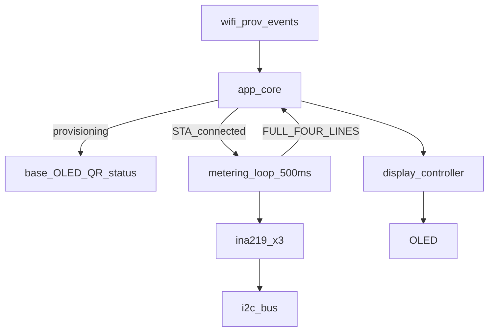

# Board Main Metering OLED Architecture — `b06_hil`

Normative particular architecture for the **main product OLED screen** and
**INA219 metering loop** on `b06_hil`.

Source handoff: `agent-workspaces/architect/handoff.md`,
`B06_MAIN_METERING_OLED`.

All agentic development methodology documentation in this firmware tree is
maintained in English.

## Purpose

Define an implementation-ready contract so an independent implementer produces
substantially the same firmware behavior:

- Reuse shared HIL base pillars (WiFi onboarding, factory reset, mDNS identity,
  OLED delivery, error-LED WiFi link).
- Add three INA219 channel reads (silk OUT 1 / 2 / 3).
- When STA is connected, show a four-line main screen: mDNS hostname on line 0,
  per-channel voltage and current on lines 1–3.
- Particular host API metering commands are specified separately in
  `docs/board_host_api_metering_architecture.md` (handoff
  `B06_HOST_API_METERING`); not required to close this OLED handoff.

## Related documents

| Document | Role |
| --- | --- |
| `docs/board_functional_description.md` | Product mission |
| `docs/board_hardware_description.md` | Pins, silk↔INA219 map, shunt provisional |
| `docs/board_particular_scope.md` | Particular vs base scope |
| `docs/board_host_api_extensions.md` | Metering host API **out of this handoff** |
| `docs/display_delivery_contract.md` | Only `app_core` → `display_controller_*` |
| `docs/oled_text_display_interface.md` | `FULL_FOUR_LINES`, MEDIUM width budget |
| `docs/device_discovery_mdns_architecture.md` | Hostname `HIL-06-<MAC4>` |
| `docs/wifi_provisioning_architecture.md` | Base provisioning / connected events |
| `docs/i2c_bus_architecture.md` | Shared bus; optional `ina219` client |

## Normative language

`MUST` / `MUST NOT` / `SHOULD` / `MAY` follow RFC-style usage as in base OLED
and display-delivery docs.

## Scope

### In scope

- Particular component `components/ina219/` (three slaves).
- Board constants for HIL number `"06"`, INA219 addresses, provisional shunt.
- `app_core` orchestration that:
  - keeps base provisioning / failure / factory-reset OLED UX unchanged;
  - on STA connected success/restore events, **replaces** the base five-line
    `WIFI OK` / IP / MAC connected screen with the metering layout;
  - runs a 500 ms metering sample loop and pushes display updates.
- ASCII line formatting and channel identity rules below.

### Out of scope (this handoff)

- Particular host API command names, JSON fields, or units for V/I/P.
- Showing power (watts) on the OLED.
- Passive channel LEDs `D1` / `D2` / `D4` and `OUT_PW_LED*` nets.
- Runtime / NVS shunt calibration UI.
- Changing family WiFi, discovery, display-delivery, or OLED glyph contracts.
- Showing STA IPv4 or STA MAC on the connected OLED (removed in favor of
  metering; identity remains via SoftAP/mDNS string and future host `info`).

## Human decisions frozen for this handoff

1. Metering OLED is shown **only while WiFi STA is connected**. It replaces the
   base connected status screen.
2. SoftAP provisioning, connect-in-progress, connect-failure flash, and factory
   reset UX remain **base** screens.
3. Particular metering **host API** is deferred to a later architect handoff.

## Visibility rules

```text
Provisioning SoftAP / QR / connecting / failure / factory-reset UX
        →  base OLED templates (unchanged)

STA connected events (at least):
  WIFI_PROV_EVENT_SUBMITTED_SUCCESS
  WIFI_PROV_EVENT_SAVED_SUCCESS
  WIFI_PROV_EVENT_RUNTIME_RESTORED
  WIFI_PROV_EVENT_CONNECT_RESTORED
        →  start or keep metering loop;
           show metering FULL_FOUR_LINES (not base FULL_FIVE_LINES WIFI OK)

STA lost / reconnecting (base link-down UX)
        →  stop or pause metering display updates;
           follow base reconnect / error-LED OLED rules
```

Normative:

- On `b06_hil`, any function equivalent to base `show_wifi_connected_display()`
  **MUST NOT** call `DISPLAY_TEMPLATE_FULL_FIVE_LINES` with `WIFI OK` / IP /
  split MAC.
- It **MUST** show the metering layout defined in **Main OLED layout**.
- Metering display updates **MUST NOT** run during SoftAP provisioning.
- Enter the metering screen only when device identity
  `HIL-06-<MAC4>` is available (same SoftAP/mDNS string, without `.local`).

## Main OLED layout

Template: `DISPLAY_TEMPLATE_FULL_FOUR_LINES`.  
Font policy: **MEDIUM** (8 px glyph → max **16** printable ASCII characters per
full-width line; see `docs/oled_text_display_interface.md` § String width
budget).

```text
Line 0: HIL-06-<MAC4>          # mDNS / SoftAP identity; no ".local"
Line 1: 1 5.00V  0.12A         # silk OUT 1 (sign column kept for I)
Line 2: 2 5.01V  0.00A         # silk OUT 2
Line 3: 3 4.98V -0.05A         # silk OUT 3 (example negative I)
```

### Line 0 — hostname

- Source: `device_identity` product hostname string (same as SoftAP SSID and
  mDNS hostname without `.local`).
- Example: `HIL-06-24CE` (11 characters ≤ 16).
- Printable ASCII only; no accents.

### Lines 1–3 — channel V / I (fixed columns)

Goal: decimal points, units, and digits **MUST NOT** shift horizontally when
current changes sign. Reserve a dedicated **sign column** for current.

Fixed character columns (0-based, total **14** printable chars ≤ 16):

```text
Index:  0 1 2 3 4 5 6 7 8 9 10 11 12 13
        N   V . V V V   s A  .  A  A  A
Example +I: 1 5 . 0 0 V   0 .  1  2  A
Example -I: 1 5 . 0 0 V - 0 .  1  2  A
```

| Columns | Field | Width | Content |
| --- | --- | --- | --- |
| 0 | Channel | 1 | Silk digit `1` / `2` / `3` |
| 1 | Separator | 1 | ASCII space |
| 2–6 | Voltage | 5 | `N.NNV` (two fractional digits + `V`) |
| 7 | Separator | 1 | ASCII space |
| 8 | Current sign | 1 | ASCII space if `I >= 0`; `-` if `I < 0` |
| 9–13 | Current mag | 5 | `N.NNA` from `fabs(I)` (two fractional digits + `A`) |

Conceptual format (C-like; magnitude uses absolute value):

```text
"%d %4.2fV %c%4.2fA", channel, voltage_v, (current_a < 0) ? '-' : ' ', fabsf(current_a)
```

Examples (all exactly 14 characters; columns stable):

```text
1 5.00V  0.12A
2 5.01V  0.00A
3 4.98V -0.05A
```

Rules:

- Channel index digit **MUST** be silk OUT number `1`, `2`, or `3`.
- Voltage and current magnitude **MUST** use two fractional digits.
- Units **MUST** be literal ASCII `V` and `A` immediately after the numeric
  magnitude (no space between number and unit).
- Current sign column (index 8) **MUST** always be present: space for
  zero/positive, `-` for negative. **MUST NOT** omit the column on positive
  readings (that would shift digits right when a minus appears).
- Voltage is treated as non-negative for this OLED path (bus voltage). Do not
  put a minus in the voltage field on this screen.
- Values whose formatted magnitude would exceed the 4-character numeric body
  before the unit (i.e. not fitting `%4.2f` style `N.NN`) **MUST** be clamped
  for display to the representable range `0.00`..`9.99` for that field’s
  magnitude (sign column still applies to current). Exact clamp policy:
  saturate to `9.99` / `0.00` as appropriate; do not widen the line.
- Unsupported / non-ASCII sanitize to `?` per base OLED rules (product format
  strings above are ASCII-only by construction).

### Per-channel read failure placeholder

If a channel's I2C read fails for that cycle, that line **MUST** use the same
14-character column layout:

```text
N ----V  ----A
```

where `N` is `1`, `2`, or `3`, column 8 is a space, and voltage/current bodies
are `----V` / `----A`. Example: `1 ----V  ----A` (14 characters).

Other channels **MUST** still update normally. A single channel failure
**MUST NOT** stop the metering loop.

### Delivery path

```text
app_core metering loop
        --app_core_display_show_template(FULL_FOUR_LINES, lines, 4)-->
display_controller
        --> display task / renderer / OLED
```

- **Only `app_core`** MAY call `display_controller_*` / public
  `app_core_display_show_*` (base display delivery contract).
- `components/ina219` **MUST NOT** include `app_core.h`, display headers, WiFi
  headers, or call display APIs.

## Sampling and refresh

| Parameter | Value |
| --- | --- |
| Product sample period | **500 ms** (2 Hz) per full three-channel cycle |
| Read order each cycle | OUT 1 → OUT 2 → OUT 3 |
| Quantities for OLED | Bus voltage (V) and current (A) |
| Power on OLED | **Forbidden** in this handoff |
| Display updates per cycle | **One** `FULL_FOUR_LINES` instruction after the cycle |
| Display refresh limit | Respect `DEFAULT_REFRESH_LIMIT_HZ = 10`; 2 Hz is compliant |

Rules:

- After each cycle (including partial failures with placeholders), `app_core`
  **MUST** issue at most one display template update with the four lines.
- The metering loop **MAY** live in `app_core` or a submodule such as
  `app_core_metering`, but ownership of display calls remains `app_core`.
- While metering is active, do not also push the base connected five-line
  screen.

## Channel map (canonical)

| Silk | Line | INA219 | I2C addr | Board constant |
| --- | --- | --- | --- | --- |
| OUT 1 | 1 | U3 | `0x42` | `BOARD_INA219_OUT1_ADDR` |
| OUT 2 | 2 | U2 | `0x41` | `BOARD_INA219_OUT2_ADDR` |
| OUT 3 | 3 | U1 | `0x40` | `BOARD_INA219_OUT3_ADDR` |

Authoritative detail: `docs/board_hardware_description.md`.

## Component boundaries



### `components/board/`

**MUST** expose (names normative for this board):

```text
BOARD_HIL_NUMBER_STRING = "06"
BOARD_INA219_OUT1_ADDR = 0x42
BOARD_INA219_OUT2_ADDR = 0x41
BOARD_INA219_OUT3_ADDR = 0x40
BOARD_INA219_SHUNT_OHMS = 0.1f   # provisional until BOM R5/R6/R8 confirmed
```

Plus existing / base-aligned GPIO constants for I2C, error LED, factory reset
from `docs/board_hardware_description.md`.

GPIO literals **MUST NOT** appear outside `components/board/`.

### `components/ina219/` (particular)

Public contract:

```c
status_t ina219_init(i2c_bus_device_t device, float shunt_ohms);
status_t ina219_read_bus_voltage_v(i2c_bus_device_t device, float *out_v);
status_t ina219_read_current_a(i2c_bus_device_t device, float *out_a);
```

- `ina219_init` **MUST** configure calibration for the supplied shunt ohms.
- The driver **MAY** also expose power (W) reads for a future host API handoff;
  the OLED path in this handoff **MUST NOT** display power.
- After base I2C phase 2, transfers **MUST** use `i2c_bus_transceive`.
- After base I2C phase 3, transfers **MUST** use `i2c_broker_submit` with
  client `I2C_CLIENT_INA219`, recommended priority **150**, typical timeout
  **20 ms** (`docs/i2c_bus_architecture.md`).
- If the working copy only has an earlier I2C phase when porting base, use the
  active phase path; do not invent a broker absent from the tree.
- Register three devices via `i2c_bus` at the board addresses above.

### `components/app_core/`

- Owns WiFi event → screen selection (base vs metering).
- Owns metering loop start/stop around STA connected / link-down.
- Formats the four ASCII lines and calls
  `app_core_display_show_template(DISPLAY_TEMPLATE_FULL_FOUR_LINES, lines, 4)`.
- **MUST NOT** put INA219 register protocol inside unrelated WiFi modules.
- `wifi_provisioning` remains display-decoupled (neutral events only).

## Base pillars unchanged

Implementers **MUST** preserve base behavior for:

- WiFi provisioning SoftAP / HTTP portal / NVS credentials
- GPIO7 10 s factory reset
- mDNS hostname announcement on STA IPv4
- Error LED WiFi link mapping
- Display delivery: instruction sources notify `app_core`; only `app_core`
  calls `display_controller_*`

Board number for identity is **`06`** → `HIL-06-<MAC4>`.

## Non-goals (recap)

- Host API metering commands / streams
- OLED power (W) lines
- Passive LEDs and `OUT_PW_LED*`
- Shunt calibration via NVS or UI
- Forking family WiFi / discovery / host transport contracts

## Open questions (do not block UI bring-up)

1. Real BOM shunt ohms for `R5` / `R6` / `R8` — firmware uses provisional
   `BOARD_INA219_SHUNT_OHMS = 0.1f`; wrong value skews current, not layout.
2. OLED I2C address `0x3C` vs `0x3D` on built hardware.
3. Production default for solder jumper `JP1`.
4. Host API metering surface — see
   `docs/board_host_api_metering_architecture.md` (`B06_HOST_API_METERING`).

## Acceptance criteria

1. With STA connected, OLED shows exactly four lines: hostname without
   `.local`, then OUT 1 / 2 / 3 voltage and current in the fixed-column format
   above (current sign column always present; digits do not shift when `I`
   changes sign).
2. During SoftAP provisioning, base QR/status UX runs; metering screen
   **MUST NOT** appear.
3. SoftAP SSID, mDNS hostname, and OLED line 0 use the same
   `HIL-06-<MAC4>` string (no `.local` on OLED).
4. Silk OUT 1 reads `0x42`, OUT 2 `0x41`, OUT 3 `0x40`.
5. `ina219` does not include `app_core.h`, display headers, or WiFi headers.
6. Only `app_core` calls display controller / `app_core_display_show_*` APIs.
7. Metering refresh is approximately 2 Hz and does not exceed the 10 Hz
   display refresh limit.
8. I2C failure on one channel yields that channel's placeholder line; the loop
   continues for other channels.
9. Particular host API metering commands are **not** required to close this
   handoff.

## Validation notes (tester)

- Confirm line formatting length ≤ 16 characters for representative V/I values
  in the expected 5 V rail range.
- Confirm switching: provisioning QR → after successful STA connect → metering
  four-line screen.
- Confirm reconnect / link-down follows base UX (no stuck metering overlay
  during SoftAP).
- Current accuracy vs lab meter is advisory until BOM shunt is confirmed.
